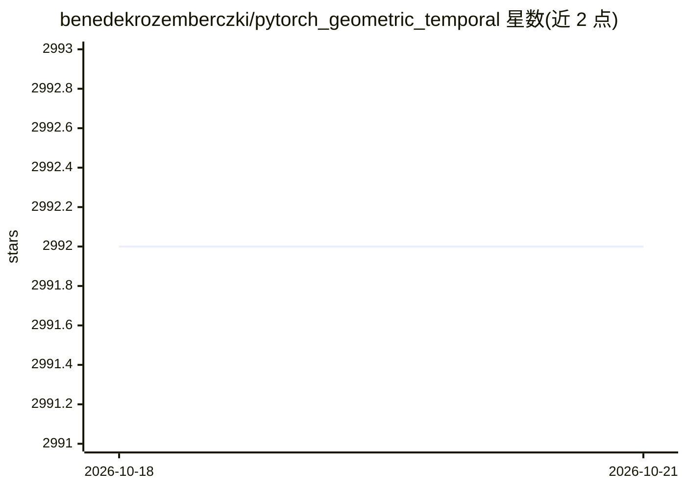

# benedekrozemberczki/pytorch_geometric_temporal

⭐ 2,992 · Python · MIT · 推送 2026-05-30 · [GitHub](https://github.com/benedekrozemberczki/pytorch_geometric_temporal) · 个人维护

**面向研究者的时序图神经网络模型库：动态图深度学习扩展**

PyTorch Geometric 的时序（动态）扩展库，收录来自已发表论文的动态/时序几何深度学习、嵌入与时空回归方法（DCRNN、GConvGRU、EvolveGCN、STGCN、GMAN 等约 20 余种），并提供数据集加载器、训练-测试分割器、时序快照迭代器及流行病预测、共享经济、能源生产、网络流量管理等基准数据集。支持 GPU、index-batching 省显存批处理、Dask-DDP 分布式训练，可配合 PyTorch Lightning 使用。需先安装 PyTorch 与 PyTorch Geometric 后 pip 安装。

## 筛选速览

| 维度 | 判定 | 备注 |
|---|---|---|
| AI 角色 | `ai-native` | 本体是模型或模型工具 |
| 许可风险 | `permissive` | MIT |
| 部署形态 | `library` | 以包/库形式分发 |
| 模型依赖 | — | README 未给出锁定关系 |
| 硬件要求 | — | 无带数字的原话,不猜 |
| 安装摩擦 | `low` | 无编译、无系统依赖或容器化 |
| 成熟度 | — | 结构信号不足 |

## 能力要点

- 收录 20 余种来自发表论文的时序图神经网络（循环图卷积/注意力时空卷积/辅助卷积）
- 提供数据集加载器、train-test 分割器与时序快照迭代器
- index-batching 提升时空批处理显存效率，Dask-DDP 支持分布式训练
- 内置流行病预测、网络流量、能源等基准数据集

## 适用场景

- 实现动态图/时序图上的预测任务（如交通、疫情预测）
- 复现和比较已发表的时空 GNN 方法
- 在自建时序图数据上训练时空回归模型

## 场景标签

 · 领域:图机器学习/时空信号处理

## 证据(README 行号)

> L12: *PyTorch Geometric Temporal* is a temporal (dynamic) extension library for PyTorch Geometric.
> L14:  The library consists of various dynamic and temporal geometric deep learning, embedding, and spatio-temporal regre
> L61: In detail, the following temporal graph neural networks were implemented.

## 星数曲线

2026-10-18 2,992 → 2026-10-21 2,992（+0）

---
*卡片 v1 · prompt 1.4 · 生成 2026-10-20 · 置信度 high · 依据 README sha `53b68b9b878b` · [字段定义](../../DATASET.md)*
