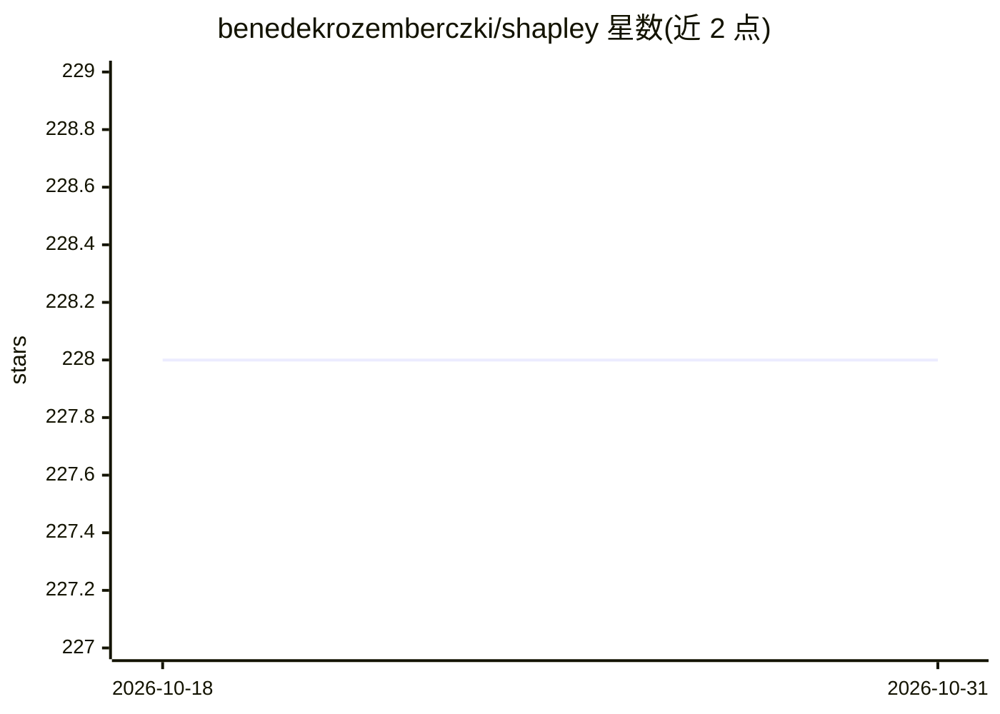

# benedekrozemberczki/shapley

⭐ 228 · Python · MIT · 推送 2026-01-01 · [GitHub](https://github.com/benedekrozemberczki/shapley) · 个人维护

**计算集成学习中分类器 Shapley 值的 Python 库**

CIKM 2021 论文 "The Shapley Value of Classifiers in Ensemble Games" 的官方实现。提供加权投票博弈（集成博弈）中各模型（玩家）Shapley 值的精确枚举与多种近似算法（期望边际贡献、多线性扩展、蒙特卡洛排列采样等），并含基于 Shapley 熵的玩家池异质性分析功能。面向机器学习研究者和开发者，附文档、教程、玩具示例与 100% 测试覆盖，pip 安装，MIT 许可。

## 筛选速览

| 维度 | 判定 | 备注 |
|---|---|---|
| AI 角色 | `ai-native` | 本体是模型或模型工具 |
| 许可风险 | `permissive` | MIT |
| 部署形态 | `library` | 以包/库形式分发 |
| 模型依赖 | — | README 未给出锁定关系 |
| 硬件要求 | — | 无带数字的原话,不猜 |
| 安装摩擦 | `low` | 无编译、无系统依赖或容器化 |
| 成熟度 | — | 结构信号不足 |

## 能力要点

- 精确枚举与多种近似算法计算分类器的 Shapley 值
- 基于 Shapley 熵的集成成员异质性分析
- 附带详细文档、教程与 100% 测试覆盖

## 适用场景

- 评估集成中各分类器对整体性能的贡献分配
- 解释并筛选集成模型中的成员
- 博弈论方法在机器学习中的研究复现

## 场景标签

 · 领域:机器学习/可解释性

## 证据(README 行号)

> L11: *Shapley* is a Python library for evaluating binary classifiers in a machine learning ensemble.
> L13: The library consists of various methods to compute (approximate) the Shapley value of players (models) in weighted 

## 星数曲线

2026-10-18 228 → 2026-10-31 228（+0）

---
*卡片 v1 · prompt 1.4 · 生成 2026-10-22 · 置信度 high · 依据 README sha `f9cf2f7fbbcb` · [字段定义](../../DATASET.md)*
