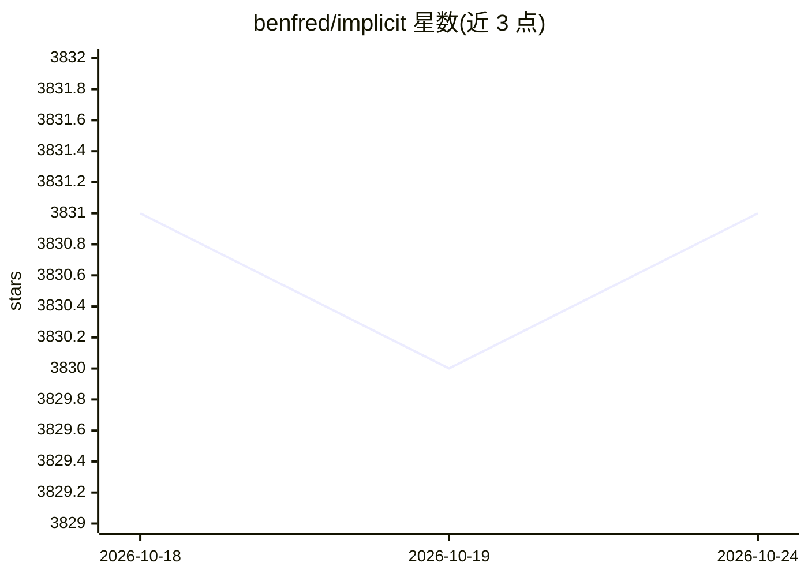

# benfred/implicit

⭐ 3,831 · Python · MIT · 推送 2026-05-08 · [GitHub](https://github.com/benfred/implicit) · [官网](https://benfred.github.io/implicit/) · 个人维护

**隐式反馈数据集的 Python 协同过滤推荐算法库**

提供 ALS、贝叶斯个性化排序（BPR）、逻辑矩阵分解及基于 Cosine/TFIDF/BM25 的 Item-Item 最近邻等推荐算法的快速 Python 实现，面向隐式反馈数据集。所有模型支持基于 Cython 与 OpenMP 的多线程训练，ALS 与 BPR 提供自定义 CUDA 核以在兼容 GPU 上拟合，并可通过 Annoy、NMSLIB、Faiss 等近似最近邻库加速推荐生成。依赖 SciPy 0.16+ 与 Python 3.9+，可从 pypi 或 conda-forge 安装，Linux 轮子含 GPU 支持。

## 筛选速览

| 维度 | 判定 | 备注 |
|---|---|---|
| AI 角色 | `ai-native` | 本体是模型或模型工具 |
| 许可风险 | `permissive` | MIT |
| 部署形态 | `library` | 以包/库形式分发 |
| 模型依赖 | — | README 未给出锁定关系 |
| 硬件要求 | — | 无带数字的原话,不猜 |
| 安装摩擦 | `medium` | 含编译或系统依赖之一 |
| 成熟度 | — | 结构信号不足 |

## 能力要点

- 实现 ALS、BPR、Logistic MF、Item-Item 最近邻（Cosine/TFIDF/BM25）等算法
- Cython+OpenMP 多线程训练，ALS/BPR 含自定义 CUDA 核
- 可接入 Annoy/NMSLIB/Faiss 加速推荐生成
- 提供 last.fm 数据集示例与文档

## 适用场景

- 在隐式反馈数据（点击、播放、购买）上训练推荐模型
- 计算相似物品（如相似艺术家）与个性化推荐
- 构建商品或内容推荐系统的研究与生产原型

## 场景标签

`推荐系统` · 领域:学习与行业

## 证据(README 行号)

> L9: This project provides fast Python implementations of several different popular recommendation algorithms for
> L21: All models have multi-threaded training routines, using Cython and OpenMP to fit the models in

## 星数曲线

2026-10-18 3,831 → 2026-10-24 3,831（+0）

---
*卡片 v1 · prompt 1.4 · 生成 2026-10-20 · 置信度 high · 依据 README sha `6c7e3ee8ae43` · [字段定义](../../DATASET.md)*
