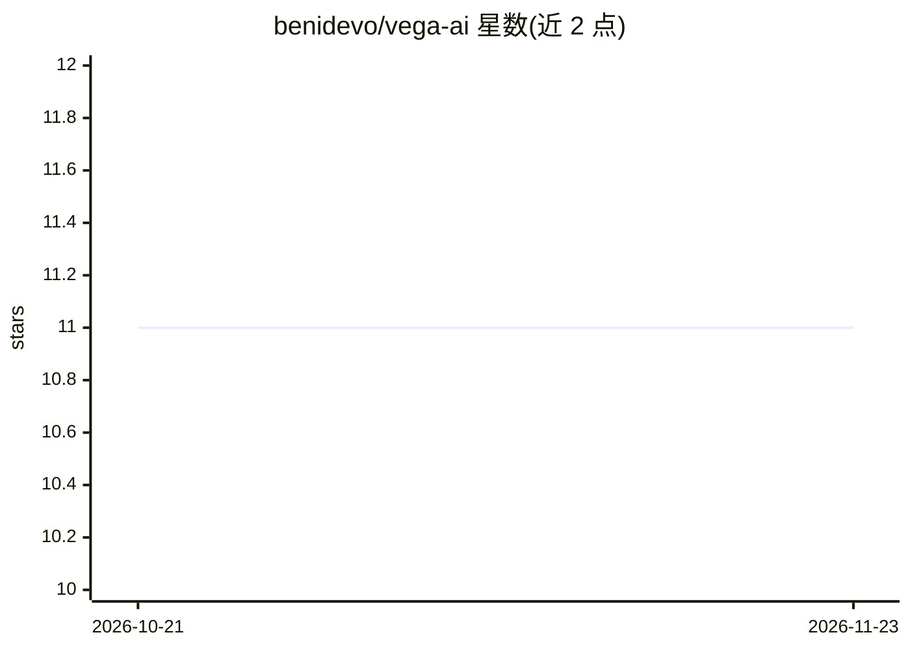

# benidevo/vega-ai

⭐ 11 · Go · NOASSERTION · 推送 2026-10-30 · [GitHub](https://github.com/benidevo/vega-ai) · [官网](https://vega.benidevo.com) · 个人维护

**自托管求职追踪系统：AI 生成简历与岗位匹配度**

面向求职者的自托管应用，功能包括申请状态追踪、针对职位描述生成定制 CV 与求职信、AI 岗位匹配评分、上传简历自动填充个人档案，以及通过 Chrome 浏览器扩展从 LinkedIn 一键抓取职位。AI 部分通过任意 OpenAI 兼容 provider 接入，默认 Gemini，支持 Ollama/LM Studio 本地运行，模型需支持 JSON mode，建议 7B+ 参数。部署方式为 Docker，支持 AMD64/ARM64、Docker Compose 与 Swarm，默认账号密码登录后需修改。

## 筛选速览

| 维度 | 判定 | 备注 |
|---|---|---|
| AI 角色 | `ai-native` | 本体是模型或模型工具 |
| 许可风险 | `none` | NOASSERTION |
| 部署形态 | `desktop` | 安装包/桌面程序 |
| 模型依赖 | local-ok | 支持本地模型 |
| 硬件要求 | — | 无带数字的原话,不猜 |
| 安装摩擦 | `low` | 无编译、无系统依赖或容器化 |
| 成熟度 | — | 结构信号不足 |

## 能力要点

- 针对职位描述生成定制 CV 与求职信
- AI 岗位匹配评分与简历解析自动填充
- 浏览器扩展从 LinkedIn 一键抓取职位
- 支持 Ollama/LM Studio 本地推理，数据留在本机

## 适用场景

- 集中追踪多渠道投递的求职进度
- 针对具体岗位生成定制化简历和求职信
- 评估自身履历与目标职位的匹配程度
- 从 LinkedIn 快速收集职位信息到追踪系统

## 场景标签

`AI 写作` · 领域:内容生成

## 证据(README 行号)

> L8: Vega AI is a self-hostable job search assistant. Track applications, generate tailored CVs and cover letters, get AI
> L85: - **CV and cover letter generation**: AI-generated documents tailored to a specific job description
> L86: - **Job match scoring**: AI analysis of how well your profile matches a job posting

## 星数曲线

2026-10-21 11 → 2026-11-23 11（+0）

---
*卡片 v1 · prompt 1.4 · 生成 2026-11-18 · 置信度 high · 依据 README sha `ca958b48a108` · [字段定义](../../DATASET.md)*
