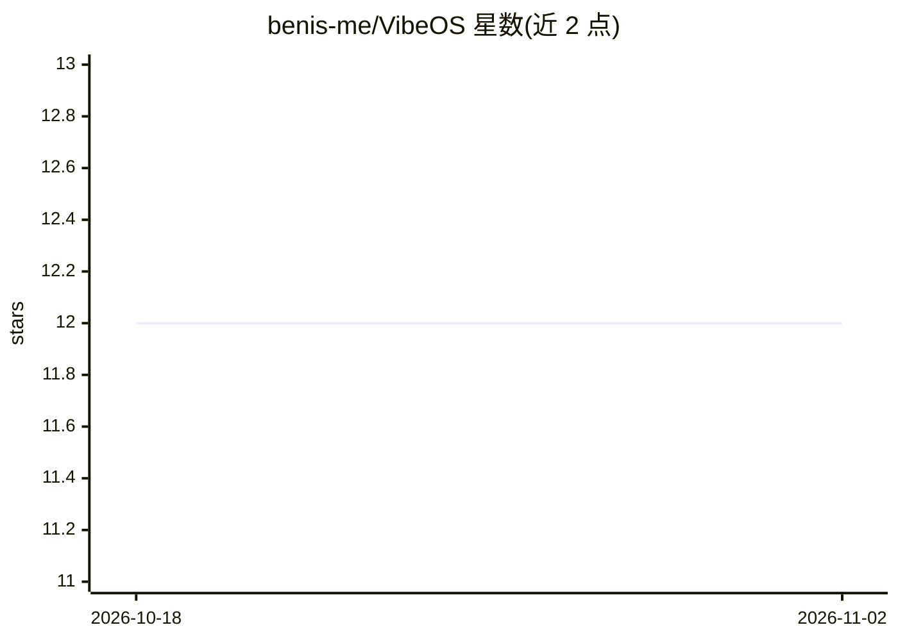

# benis-me/VibeOS

⭐ 12 · TypeScript · MIT · 推送 2026-10-12 · [GitHub](https://github.com/benis-me/VibeOS) · 个人维护 · 中文 README

**浏览器中由 AI 实时生成界面的操作系统（微软 Build 2026 demo 复刻）**

基于 Bun 后端与 Vite/React 前端的 Web 桌面操作系统：内核、窗口管理、任务栏、文件系统与 SQLite 持久化是真实的，而每个窗口的内容由 AI 模型实时生成与修补。UI 生成无状态（每次动作发送完整当前 UI 作上下文），支持多 agent 运行时、皮肤系统、应用打包导入导出。模型层经统一 AiProvider 接缝接入本地 CLI（CodeBuddy/Claude Code/Codex）或 API（OpenAI、Anthropic、Gemini、OpenRouter、MiniMax、智谱、Kimi、Cerebras），可设置切换，也提供无模型的离线 stub 模式。

## 筛选速览

| 维度 | 判定 | 备注 |
|---|---|---|
| AI 角色 | `ai-native` | 本体是模型或模型工具 |
| 许可风险 | `permissive` | MIT |
| 部署形态 | `None` |  |
| 模型依赖 | locked-api |  |
| 硬件要求 | — | 无带数字的原话,不猜 |
| 安装摩擦 | `low` | 无编译、无系统依赖或容器化 |
| 成熟度 | — | 结构信号不足 |

## 能力要点

- 窗口界面由模型实时生成/修补，UI 生成无状态、可正确重渲染
- 多 agent 运行时：UI 生成 agent（强模型）与系统事件 agent（快模型）
- 统一 AiProvider 接缝接入本地 CLI 或多家 API，可在设置中实时切换
- 应用以不可变版本管理，支持 .vibeapp 打包与真实系统磁盘文件读写

## 适用场景

- 在浏览器里用一句话生成并持续重塑一个可用的应用窗口
- 把生成的窗口保存为应用并导出分享给他人安装
- 观察每次 AI 运行的 token 用量、成本与延迟（Activity Monitor）

## 场景标签

`AI 助手` · 领域:对话与助手

## 证据(README 行号)

> L5: An **AI-hallucination-driven operating system** in the browser. Except for the
> L6: core runtime, every window's interface is generated in real time by AI: the user
> L7: acts on a window, and the system asks the model what the window should become
> L38: - **AI dynamic UI** — app windows are HTML fragments generated/patched live by the

## 星数曲线

2026-10-18 12 → 2026-11-02 12（+0）

---
*卡片 v1 · prompt 1.4 · 生成 2026-11-01 · 置信度 high · 依据 README sha `c192fad6606f` · [字段定义](../../DATASET.md)*
