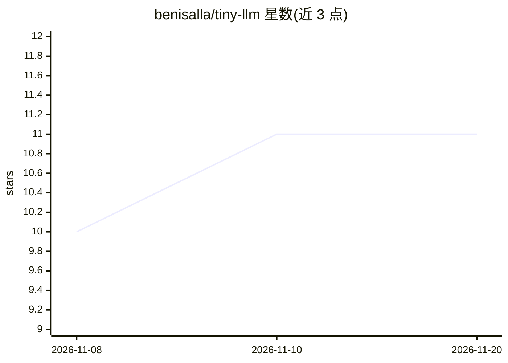

# benisalla/tiny-llm

⭐ 11 · Python · 推送 2026-10-17 · [GitHub](https://github.com/benisalla/tiny-llm) · 个人维护

**学习者用 PyTorch 从零手写的小型 LLM 实现**

个人学习项目：全部层手写的 PyTorch LLM 实现，同一套代码支持从零预训练，或加载 GPT-2、Llama/SmolLM2、Qwen2.5、Pythia 的公开权重并通过测试验证输出与 Hugging Face 逐位一致；支持 LoRA 微调、KV cache、top-k/top-p 采样与流式生成，附 Streamlit 聊天界面和可在 Kaggle/Colab 直接运行的 notebook。README 明确说明这是学习项目，不代表生产级方案。通过 ModelConfig 字段切换模型家族，权重重命名逻辑集中在 families.py。

## 筛选速览

| 维度 | 判定 | 备注 |
|---|---|---|
| AI 角色 | `ai-native` | 本体是模型或模型工具 |
| 许可风险 | `none` | — |
| 部署形态 | `library` | 以包/库形式分发 |
| 模型依赖 | — | README 未给出锁定关系 |
| 硬件要求 | — | 无带数字的原话,不猜 |
| 安装摩擦 | `low` | 无编译、无系统依赖或容器化 |
| 成熟度 | `idea` | |

## 能力要点

- 同一实现加载 GPT-2/Llama/Qwen2.5/Pythia 权重，测试验证与 Hugging Face 输出一致
- KV cache、分组查询注意力、top-k/top-p 采样与流式生成
- LoRA 微调：只训练低秩矩阵与嵌入，可合并回基础权重
- 提供 Kaggle/Colab notebook，免配置完成训练、微调与聊天

## 适用场景

- 从零理解 decoder-only transformer 的每一层实现细节
- 在笔记本或免费 GPU 上预训练/LoRA 微调一个小型语言模型
- 加载公开小模型权重并用自研代码做多轮对话

## 场景标签

`微调` `模型训练` · 领域:训练与推理

## 证据(README 行号)

> L2: Tiny LLM is my personal project: a small large language model built from scratch in PyTorch (😁 I'm still learning). 
> L127: The test suite checks that this implementation produces **the same logits and the same greedy generations as Huggi

## 星数曲线

2026-11-08 10 → 2026-11-20 11（+1）

---
*卡片 v1 · prompt 1.4 · 生成 2026-11-18 · 置信度 mid · 依据 README sha `f55b0a648181` · [字段定义](../../DATASET.md)*
