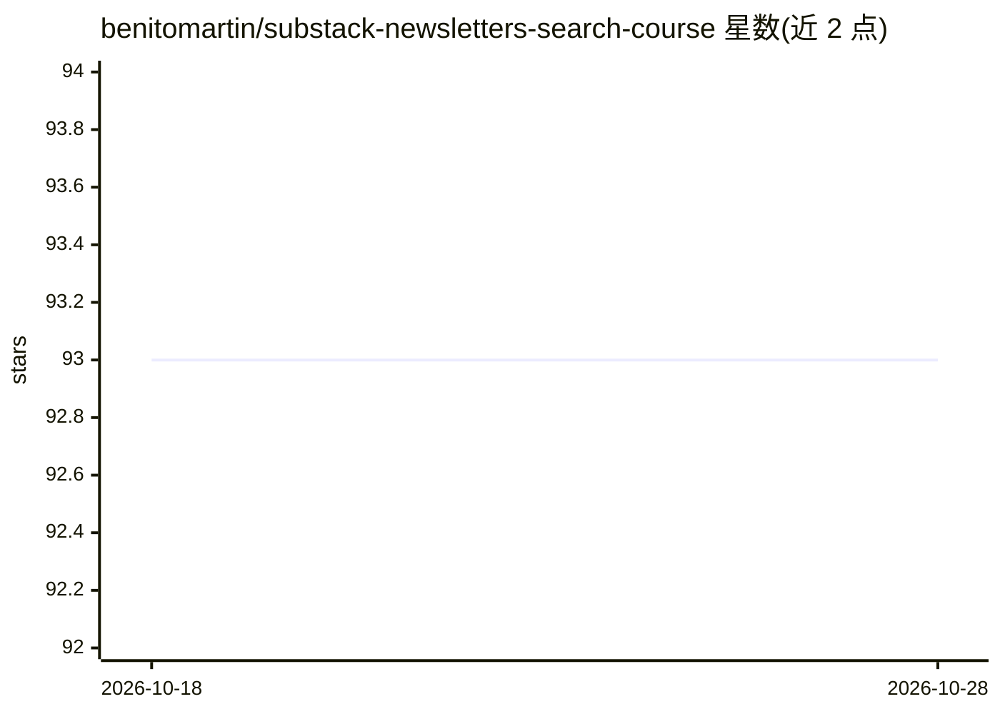

# benitomartin/substack-newsletters-search-course

⭐ 93 · Python · MIT · 推送 2026-01-29 · [GitHub](https://github.com/benitomartin/substack-newsletters-search-course) · 个人维护

**构建生产级 RAG 新闻检索系统的免费实战课程**

面向 ML/AI 工程师、软件与数据工程师的免费课程仓库，配套一个完整的 Substack 文章搜索引擎：从 RSS 摄取文章存入 Supabase，用 Qdrant 生成并索引嵌入（含量化与混合检索），以 Prefect 编排调度工作流，FastAPI 提供关键词与 LLM 搜索接口，最后部署到 Google Cloud Run 并提供 Gradio UI。支持 OpenRouter、OpenAI、Hugging Face 多个 LLM 提供商，无 GPU 即可运行，各服务免费额度即可完成。课程含 4 篇文章与 1 个视频。

## 筛选速览

| 维度 | 判定 | 备注 |
|---|---|---|
| AI 角色 | `ai-knowledge` | 知识聚合/清单类 |
| 许可风险 | `permissive` | MIT |
| 部署形态 | `None` |  |
| 模型依赖 | locked-api |  |
| 硬件要求 | `cpu-ok` | |
| 安装摩擦 | `low` | 无编译、无系统依赖或容器化 |
| 成熟度 | — | 结构信号不足 |

## 能力要点

- RSS 摄取→Supabase 存储→Qdrant 向量索引（量化、混合检索）的端到端管道
- 多 LLM 提供商接入：OpenRouter 主用，OpenAI/Hugging Face 备用
- Prefect 工作流编排 + Google Cloud Run 部署 + Gradio UI
- 无需 GPU，各服务免费层即可运行

## 适用场景

- 我想学习如何搭建可上线的 RAG 检索与问答系统
- 想实践云服务与开源组件（Supabase/Qdrant/FastAPI）集成部署
- 想把自己的 Substack 订阅内容做成可搜索的知识库

## 场景标签

`RAG` `教程课程` `语义搜索` · 领域:知识与检索

## 证据(README 行号)

> L39: Unlike basic tutorials, this course provides a comprehensive, hands-on guide to building a complete end-to-end Retr
> L59: ## 🧑‍🎓 What You Will Learn
> L91: |Lesson|Topic|Substack Article|Description|

## 星数曲线

2026-10-18 93 → 2026-10-28 93（+0）

---
*卡片 v1 · prompt 1.4 · 生成 2026-10-23 · 置信度 high · 依据 README sha `a659b88cb44f` · [字段定义](../../DATASET.md)*
