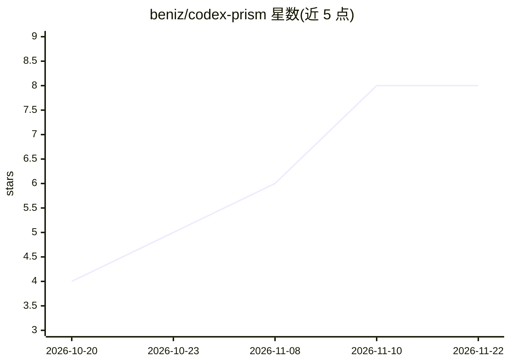

# beniz/codex-prism

⭐ — · [GitHub]() · 个人维护

**科研写作桌面应用：并行 Codex 会话协作写 LaTeX 论文/幻灯片**

面向论文、幻灯片与技术报告写作的桌面工作区，将本地文件、并行 Codex 会话、编译后的 PDF 与 Git 历史整合在一起。核心机制：多个会话各自对同一文档提出修改提案并附 PDF 预览，用户逐个 Keep/Discard，Keep 时自动合并为普通 Git 提交，冲突修改会被报告并可用 agent 修复。本地编译依赖 TeX Live 或 MiKTeX（pdfLaTeX/XeLaTeX/LuaLaTeX/BibTeX/Biber），AI 部分依赖已安装的 Codex CLI 及其账户。Linux/macOS/Windows 提供安装包，也可从源码构建。

## 筛选速览

| 维度 | 判定 | 备注 |
|---|---|---|
| AI 角色 | `ai-native` | 本体是模型或模型工具 |
| 许可风险 | `permissive` | — |
| 部署形态 | `desktop` | 安装包/桌面程序 |
| 模型依赖 | — | README 未给出锁定关系 |
| 硬件要求 | — | 无带数字的原话,不猜 |
| 安装摩擦 | `low` | 无编译、无系统依赖或容器化 |
| 成熟度 | — | 结构信号不足 |

## 能力要点

- 同一文档并行多会话提案，Keep 时自动合并并保留冲突报告
- Keep 生成普通 Git 提交，可在 History 中检查或恢复版本
- 本地 LaTeX 编译与 PDF 预览联动（TeX Live/MiKTeX）
- 支持 SSH 连接远程数据源与远程 Codex 服务器，无需挂载远程文件系统

## 适用场景

- 同时起草引言、修改图表、润色结论等多个部分
- 用模板复用会议论文/学位论文/幻灯片的样式与写作指令
- 通过 Git 远程（GitHub/Gitea）异步协作并请求评审

## 场景标签

`科研工具` `AI 写作` · 领域:内容生成

## 证据(README 行号)

> L4:  Write papers, slides, and reports with parallel Codex chats, LaTeX, and PDF review.
> L6: Work on several parts of a document at once, review the results, and keep the changes you want. codex-prism brings y
> L66: |**Parallel chats for one document**|Draft the introduction, refine figures, and revise conclusions at the same tim
> L97: - **Local compilation:** TeX Live or MiKTeX, with pdfLaTeX, XeLaTeX, LuaLaTeX, BibTeX, and Biber. Optional Auto rec

## 星数曲线

2026-10-20 4 → 2026-11-22 8（+4）

---
*卡片 v1 · prompt 1.4 · 生成 2026-11-20 · 置信度 mid · 依据 README sha `d2cb3acc4193` · [字段定义](../../DATASET.md)*
