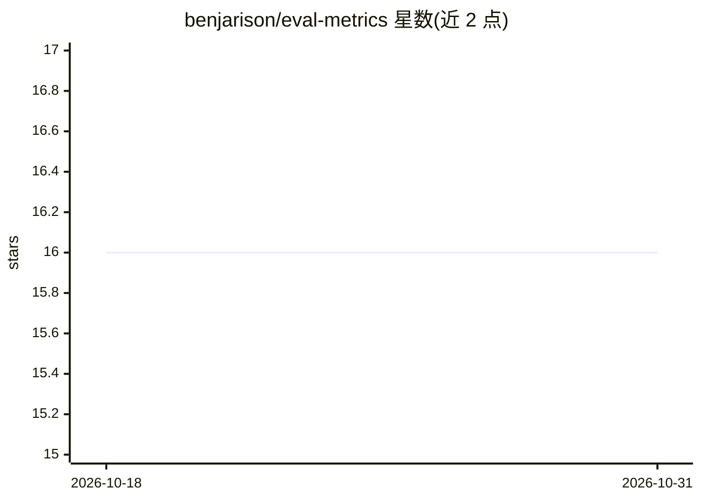

# benjarison/eval-metrics

⭐ 16 · Rust · NOASSERTION · 推送 2026-01-14 · [GitHub](https://github.com/benjarison/eval-metrics) · 个人维护

**Rust 机器学习评测指标库：分类与回归常用指标计算**

以 Rust crate 形式提供的机器学习评测指标函数库，指标按 classification 与 regression 模块组织；分类模块区分二分类与多分类，多分类指标需显式指定平均方法，另提供 ROC/PR 曲线及 AUC、AP、M-AUC 等指标；回归模块覆盖 RMSE/MSE/MAE/R²/相关系数。指标在数值上不可定义时通过 Result 类型返回错误。供需要在 Rust 项目中计算模型评测指标的开发者使用，无独立运行程序，仅作为库嵌入使用。

## 筛选速览

| 维度 | 判定 | 备注 |
|---|---|---|
| AI 角色 | `ai-ecosystem` | LLM/agent 周边工具 |
| 许可风险 | `none` | NOASSERTION |
| 部署形态 | `library` | 以包/库形式分发 |
| 模型依赖 | — | README 未给出锁定关系 |
| 硬件要求 | — | 无带数字的原话,不猜 |
| 安装摩擦 | `low` | 无编译、无系统依赖或容器化 |
| 成熟度 | — | 结构信号不足 |

## 能力要点

- 二分类/多分类/回归三类指标模块化组织
- ROC/PR 曲线计算及 AUC、AP、多分类 M-AUC
- 指标不可定义时以 Result 类型显式报错
- 多分类支持全局指标与逐类指标

## 适用场景

- 在 Rust 项目中计算分类模型的准确率、F1、MCC 等指标
- 绘制并计算 ROC/PR 曲线与 AUC/AP
- 计算回归模型的 RMSE、R² 等误差指标

## 场景标签

`模型评测` · 领域:评测与运维

## 证据(README 行号)

> L9: The goal of this library is to provide an intuitive collection of functions for computing evaluation metrics commonl
> L10: encountered in machine learning. Metrics are separated into modules for either `classification` or `regression`, wi

## 星数曲线

2026-10-18 16 → 2026-10-31 16（+0）

---
*卡片 v1 · prompt 1.4 · 生成 2026-10-30 · 置信度 high · 依据 README sha `03f47faf287c` · [字段定义](../../DATASET.md)*
