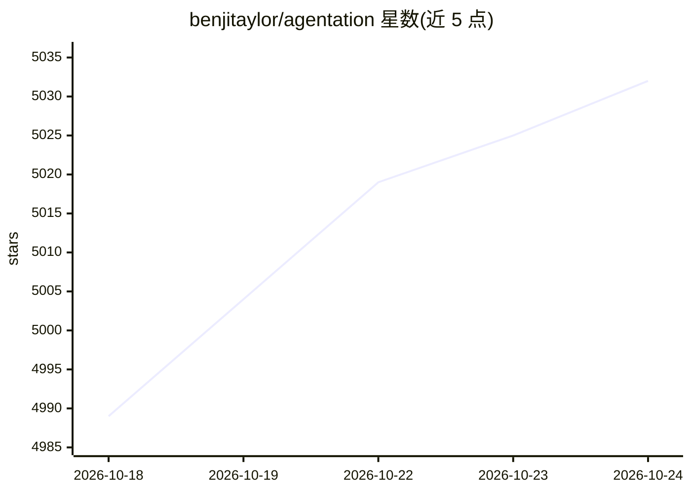

# benjitaylor/agentation

⭐ 5,045 · TypeScript · NOASSERTION · 推送 2026-09-22 · [GitHub](https://github.com/benjitaylor/agentation) · [官网](https://agentation.com) · 个人维护

**让开发者在页面上标注元素并输出结构化反馈给 AI 编程代理**

React 组件形式的可视化反馈工具：在网页右下角注入工具栏，支持点击、文本选择、多选与区域选择等标注方式，自动捕获元素的类名、选择器与位置，生成含定位信息的 Markdown 供 AI 编程代理 grep 到对应代码。复制内容可用于 Claude Code、Codex、Gemini、Grok 等；另提供 MCP server 实现与代理的直接同步。要求 React 18+ 与桌面浏览器，npm 安装。

## 筛选速览

| 维度 | 判定 | 备注 |
|---|---|---|
| AI 角色 | `ai-ecosystem` | LLM/agent 周边工具 |
| 许可风险 | `none` | NOASSERTION |
| 部署形态 | `library` | 以包/库形式分发 |
| 模型依赖 | — | README 未给出锁定关系 |
| 硬件要求 | — | 无带数字的原话,不猜 |
| 安装摩擦 | `low` | 无编译、无系统依赖或容器化 |
| 成熟度 | — | 结构信号不足 |

## 能力要点

- 点击/文本/多选/区域四种元素标注方式
- 输出含选择器、位置与上下文的结构化 Markdown
- 通过 agentation-mcp server 与 MCP 客户端直接同步
- 除 React peer 依赖外零运行时依赖

## 适用场景

- 向 AI 编程代理精确指明要修改的页面元素位置
- 在开发中的网页上对 UI 问题做可视化标注并交给代理处理
- 让代理读取标注反馈后自动定位对应源码

## 场景标签

 · 领域:软件开发工具/AI 代理协作

## 证据(README 行号)

> L6: **Agentation** is an agent-agnostic visual feedback tool. Click elements on your page, add notes, and copy structure
> L56: Agentation captures class names, selectors, and element positions so AI agents can `grep` for the exact code you're

## 星数曲线

2026-10-18 4,989 → 2026-10-24 5,032（+43）

---
*卡片 v1 · prompt 1.4 · 生成 2026-10-20 · 置信度 high · 依据 README sha `43725271a8e6` · [字段定义](../../DATASET.md)*
