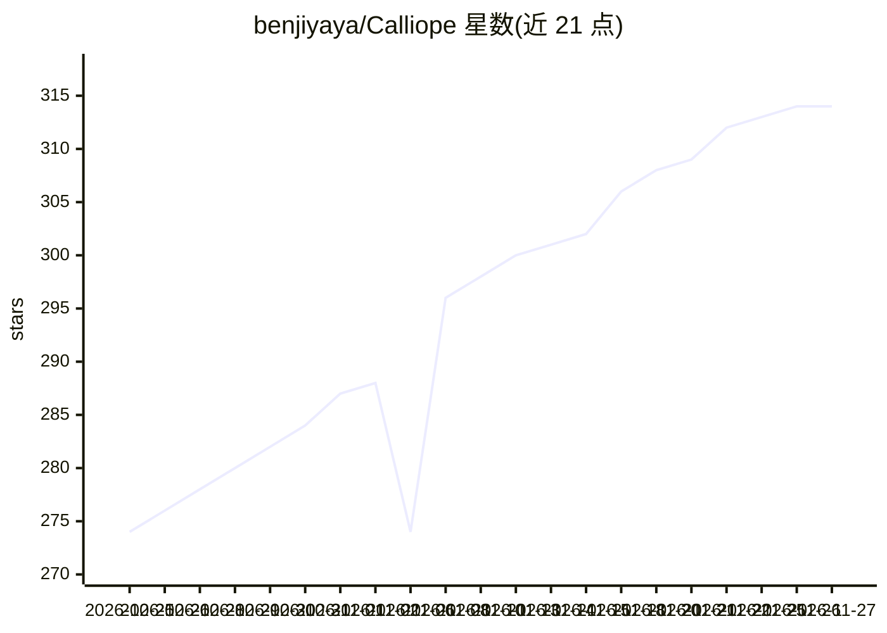

# benjiyaya/Calliope

⭐ 314 · Python · MIT · 推送 2026-11-15 · [GitHub](https://github.com/benjiyaya/Calliope) · 个人维护

**本地运行的从故事创意到视频生成的工作室，驱动自有 ComfyUI**

Calliope 是本地优先的故事转视频工作室：输入故事创意后，由 LLM 起草带节拍、角色、地点的故事线，逐场景生成剧本并切分为 5–10 秒的镜头片段，再通过用户自装的 ComfyUI 为每个片段生成视频，最后用 ffmpeg 拼接成片（叠化转场与响度归一）。项目存于 SQLite，媒体存于本地文件夹，无云端服务（LLM 端点除外）。需 Python 3.11+、Node.js 18+、运行中的 ComfyUI、OpenAI 兼容 LLM 端点与 ffmpeg，从源码安装运行。

## 筛选速览

| 维度 | 判定 | 备注 |
|---|---|---|
| AI 角色 | `ai-native` | 本体是模型或模型工具 |
| 许可风险 | `permissive` | MIT |
| 部署形态 | `desktop` | 安装包/桌面程序 |
| 模型依赖 | local-ok | 支持本地模型 |
| 硬件要求 | — | 无带数字的原话,不猜 |
| 安装摩擦 | `medium` | 含编译或系统依赖之一 |
| 成熟度 | — | 结构信号不足 |

## 能力要点

- 四阶段流水线：Story→Assets→Script→Video，逐镜头生成并一键成片
- 通过工作流节点标题中的角色标签（Input:role/Output:role）动态发现 ComfyUI 可编辑节点
- Agent 对话模式：子代理按授权工具执行工作室操作，写操作经数据库校验
- 可选 Comfy Router 云端模型（MiniMax H3 / FLUX 3）与本地工作流并存

## 适用场景

- 用自有 ComfyUI 工作流把故事创意批量生成为分镜头短片
- 通过对话让 agent 代为操作项目创建、剧本与渲染队列
- 在离线/本地环境管理素材引用图与视频生成任务

## 场景标签

`视频生成` · 领域:内容生成

## 证据(README 行号)

> L3: Calliope is a local-first story-to-video studio. You type a story idea; Calliope drafts a storyline with beats, char
> L26: - An OpenAI-compatible LLM endpoint — local (LM Studio, Ollama, etc.) or hosted

## 星数曲线

2026-10-25 274 → 2026-11-27 314（+40）

---
*卡片 v1 · prompt 1.4 · 生成 2026-11-25 · 置信度 mid · 依据 README sha `763fe2ca398d` · [字段定义](../../DATASET.md)*
