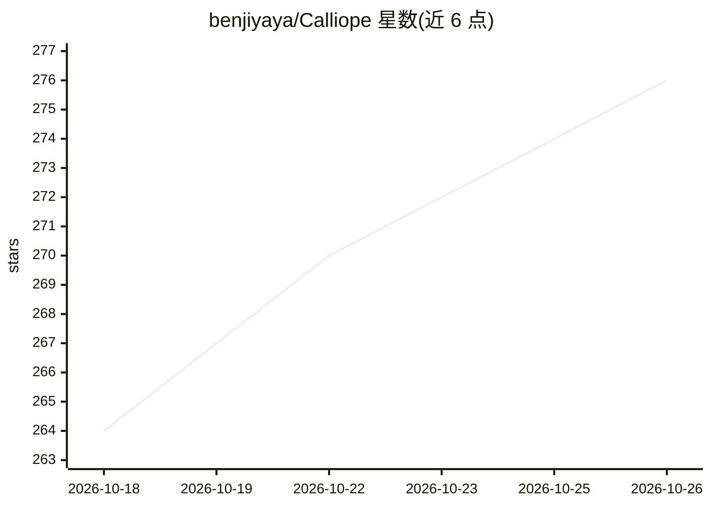

# benjiyaya/Calliope

⭐ 276 · Python · MIT · 推送 2026-10-17 · [GitHub](https://github.com/benjiyaya/Calliope) · 个人维护

**本地化故事转视频工作室：从创意到成片驱动 ComfyUI 生成**

本地优先的故事到视频生成应用：输入故事创意后，由多 agent（主 agent、规划、故事、剧本、资产、视频）经 OpenAI 兼容 LLM 端点起草情节、剧本，把场景拆成约 5-10 秒的镜头片段，通过用户自装的 ComfyUI 队列渲染各片段，再用 ffmpeg 拼接、响度归一出成片。项目数据存 SQLite，不依赖云服务（除自配的 LLM 端点）。技术栈为 FastAPI + SvelteKit，需从源码安装，前置要求 Python 3.11+、Node.js 18+、ComfyUI 与 ffmpeg。

## 筛选速览

| 维度 | 判定 | 备注 |
|---|---|---|
| AI 角色 | `ai-native` | 本体是模型或模型工具 |
| 许可风险 | `permissive` | MIT |
| 部署形态 | `desktop` | 安装包/桌面程序 |
| 模型依赖 | — | README 未给出锁定关系 |
| 硬件要求 | — | 无带数字的原话,不猜 |
| 安装摩擦 | `medium` | 含编译或系统依赖之一 |
| 成熟度 | — | 结构信号不足 |

## 能力要点

- 多 agent 流水线：故事→资产→剧本→镜头拆分→视频生成
- 通过角色标签发现 ComfyUI 工作流节点，不硬编码节点 ID
- 支持 MiniMax H3 六段式提示词确定性编译
- Agents 对话模式经工具操作同一数据库与渲染队列

## 适用场景

- 把故事创意做成分镜头 AI 视频并导出成片
- 用自己的 ComfyUI 工作流本地生成角色、场景参考图与视频片段
- 通过对话让 agent 代跑完整制作流水线

## 场景标签

`视频生成` `多智能体` · 领域:Agent 开发

## 证据(README 行号)

> L3: Calliope is a local-first story-to-video studio. You type a story idea; Calliope drafts a storyline with beats, char
> L87: - **Script:** **Regenerate Script** also opens a project-linked Agents chat (pre-filled) to rewrite the per-scene s

## 星数曲线

2026-10-18 264 → 2026-10-26 276（+12）

---
*卡片 v1 · prompt 1.4 · 生成 2026-10-22 · 置信度 high · 依据 README sha `37ba0b18053f` · [字段定义](../../DATASET.md)*
