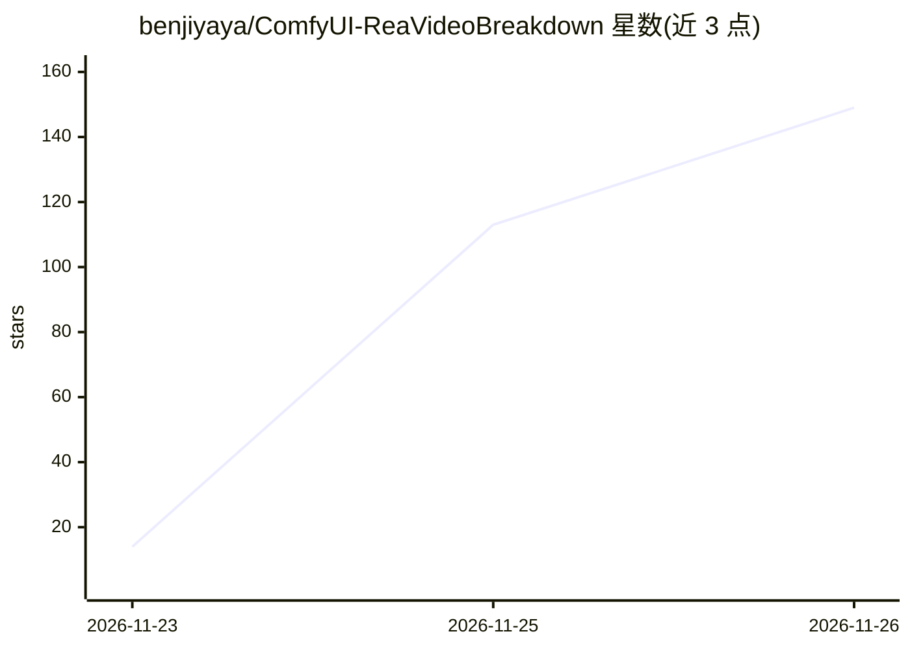

# benjiyaya/ComfyUI-ReaVideoBreakdown

⭐ 149 · Python · MIT · 推送 2026-11-24 · [GitHub](https://github.com/benjiyaya/ComfyUI-ReaVideoBreakdown) · 个人维护 · 中文 README

**ComfyUI 节点：逐镜头拆解视频并生成文生视频提示词**

以单个 ComfyUI 自定义节点形式提供逐镜头视频逆向拆解：先用 OpenCV（HSV 直方图+像素差、自适应阈值）做镜头切分，再用 Lucas–Kanade 光流加 RANSAC 测量运镜（pan/zoom/手持），然后通过 ComfyUI 原生 CLIPLoader 加载的 VLM 文本编码器逐镜头生成制作方式判定、内容描述、镜头语言与可用的文生视频提示词，输出 VIDEO.md、结构化 JSON、分隔提示词与关键帧。支持 en/zh 报告；节点本身除 numpy/opencv 外无额外依赖。仅做视觉分析，不含音频/OCR。

## 筛选速览

| 维度 | 判定 | 备注 |
|---|---|---|
| AI 角色 | `ai-native` | 本体是模型或模型工具 |
| 许可风险 | `permissive` | MIT |
| 部署形态 | `library` | 以包/库形式分发 |
| 模型依赖 | — | README 未给出锁定关系 |
| 硬件要求 | — | 无带数字的原话,不猜 |
| 安装摩擦 | `low` | 无编译、无系统依赖或容器化 |
| 成熟度 | — | 结构信号不足 |

## 能力要点

- 镜头切分与逐镜头分析（制作方式、内容、运镜测量）
- 复用 ComfyUI 原生 VLM 文本编码器路径（CLIPLoader），节点零额外依赖
- 输出 VIDEO.md、结构化 JSON、逐镜头分隔提示词与关键帧
- 支持中英文报告与提示词切换

## 适用场景

- 把现有视频拆解为逐镜头提示词，接入 Wan/Kling/Veo/Sora 类节点重制
- 分析一段视频由实拍、AI 生成还是 3D 渲染构成
- 为剪辑流程提取镜头边界与时码顺序

## 场景标签

`视频生成` `图像视频处理` · 领域:内容生成

## 证据(README 行号)

> L8: **Shot-by-shot video reverse engineering** (the rea-video idea) as a single ComfyUI custom node.
> L31: You load a **vision-language text encoder** with the core **CLIPLoader**
> L48: video frames ──▶ shot detection (OpenCV, CPU) ──▶ per shot: sample N frames ──▶ native VLM ──▶ JSON record ──▶ VIDE

## 星数曲线

2026-11-23 14 → 2026-11-26 149（+135）

---
*卡片 v1 · prompt 1.4 · 生成 2026-11-23 · 置信度 high · 依据 README sha `075eb70875e4` · [字段定义](../../DATASET.md)*
