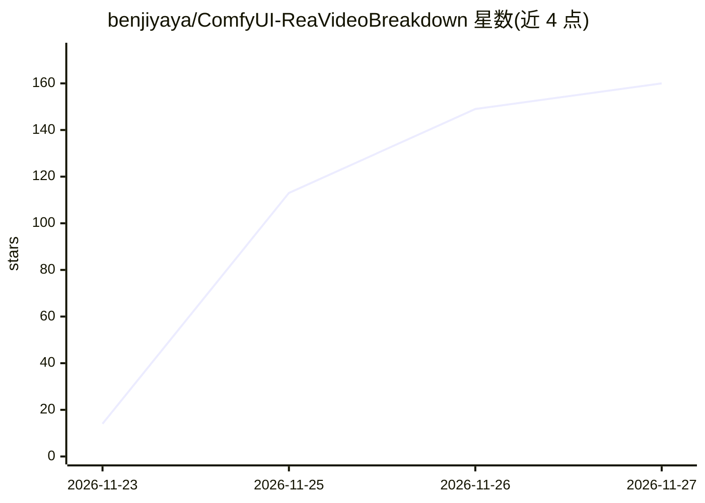

# benjiyaya/ComfyUI-ReaVideoBreakdown

⭐ 160 · Python · MIT · 推送 2026-11-24 · [GitHub](https://github.com/benjiyaya/ComfyUI-ReaVideoBreakdown) · 个人维护 · 中文 README

**ComfyUI 节点：逐镜头解析视频并生成文生视频提示词**

以两个 ComfyUI 自定义节点实现逐镜头视频逆向解析：节点 1 用 OpenCV 做镜头切分（HSV 直方图+像素差）与光流运动测量，再经 ComfyUI 原生 VLM 文本编码器路径（CLIPLoader，tokenize→generate→decode）对每个镜头输出来源类型、内容描述、镜头运动与可用文生视频提示词，输出 VIDEO.md、结构化 JSON 与分隔提示词；节点 2 将解析结果加参考图改写为 MiniMax H3 Ref2VA 格式提示词。安装仅需 git clone + pip（numpy/opencv），需较新版本 ComfyUI；不支持音频分析、OCR 与字幕导出。

## 筛选速览

| 维度 | 判定 | 备注 |
|---|---|---|
| AI 角色 | `ai-native` | 本体是模型或模型工具 |
| 许可风险 | `permissive` | MIT |
| 部署形态 | `library` | 以包/库形式分发 |
| 模型依赖 | — | README 未给出锁定关系 |
| 硬件要求 | — | 无带数字的原话,不猜 |
| 安装摩擦 | `low` | 无编译、无系统依赖或容器化 |
| 成熟度 | — | 结构信号不足 |

## 能力要点

- OpenCV 镜头检测（HSV 直方图距离+自适应阈值）与光流+RANSAC 运动测量
- 经 ComfyUI 原生 VLM 文本编码器路径逐镜头生成描述与提示词，无需额外 API
- 输出 VIDEO.md 报告、结构化 JSON 与按镜头分隔的文生视频提示词
- 支持 en/zh 报告语言切换与离线 CPU 测试套件

## 适用场景

- 拆解一段视频的镜头构成、制作方式与运镜参数
- 为每个镜头生成可直接投入文生视频模型的提示词
- 带参考图改写整段视频为 MiniMax H3 Ref2VA 格式提示词
- 用中文输出解析报告与提示词

## 场景标签

`视频生成` `图像视频处理` · 领域:内容生成

## 证据(README 行号)

> L8: **Shot-by-shot video reverse engineering** (the rea-video idea) as two ComfyUI nodes:
> L10: 1. **Video Breakdown (Rea · native VLM)** — point it at any video and it splits the footage into shots, then for **
> L14:  - **a ready-to-use text-to-video prompt** — one per shot, delimited and wired straight into your favourite video m

## 星数曲线

2026-11-23 14 → 2026-11-27 160（+146）

---
*卡片 v1 · prompt 1.4 · 生成 2026-11-27 · 置信度 high · 依据 README sha `172b919525ef` · [字段定义](../../DATASET.md)*
