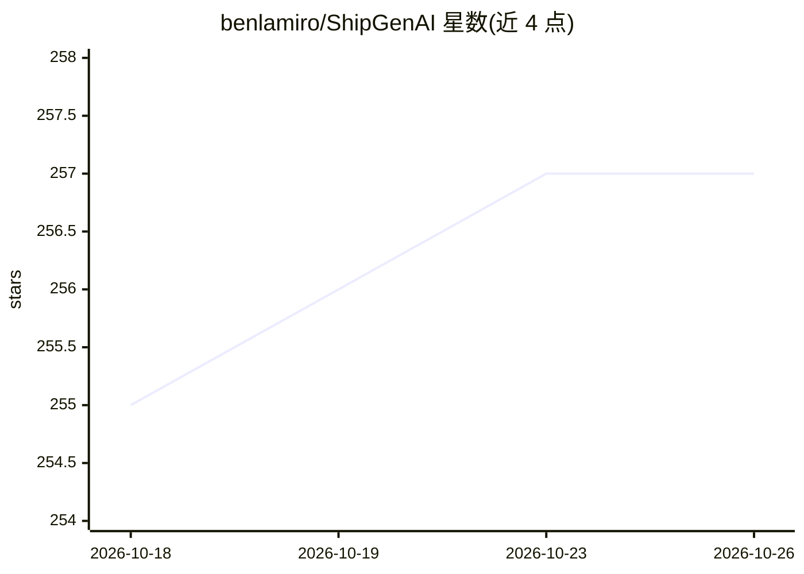

# benlamiro/ShipGenAI

⭐ 257 · JavaScript · MIT · 推送 2026-09-22 · [GitHub](https://github.com/benlamiro/ShipGenAI) · [官网](https://shipgenai.site/) · 个人维护

**50 个可白标商用的生成式 AI SaaS 应用模板合集**

面向独立开发者的策展仓库：收录 50 个完整的生成式 AI SaaS 产品模板，覆盖图像/视频生成、美妆试穿、电商摄影、虚拟家居、写作、客服机器人等类别。每个模板统一技术栈：Next.js + NextAuth(Google OAuth) + Prisma/PostgreSQL + Stripe 计费（积分扣减与 webhook），AI 能力经由 MuAPI 接入 100+ 模型（异步轮询、重试、故障转移），支持 Vercel 一键部署。各条目附同类商业产品及定价对照表。MIT 许可，clone 后可自有品牌售卖。

## 筛选速览

| 维度 | 判定 | 备注 |
|---|---|---|
| AI 角色 | `ai-knowledge` | 知识聚合/清单类 |
| 许可风险 | `permissive` | MIT |
| 部署形态 | `None` |  |
| 模型依赖 | — | README 未给出锁定关系 |
| 硬件要求 | — | 无带数字的原话,不猜 |
| 安装摩擦 | `low` | 无编译、无系统依赖或容器化 |
| 成熟度 | — | 结构信号不足 |

## 能力要点

- 50 个含计费、认证、数据库的完整 SaaS 模板
- 统一栈：Next.js/Prisma/Stripe/MuAPI(100+模型)/Vercel
- 每条目标注同类商业竞品与定价对照
- MIT 许可，可白标并保留全部收入

## 适用场景

- 独立开发者快速上线自己的 AI SaaS 产品并接入付费
- 对比各类 AI SaaS 细分赛道与现有商业产品定价
- 学习含 Stripe 计费与 OAuth 的 Next.js 全栈架构

## 场景标签

`图像生成` `视频生成` `精选清单` · 领域:内容生成

## 证据(README 行号)

> L36: **ShipGenAI** is a curated collection of **50 complete, production-ready AI SaaS products** you can launch under yo
> L41: - 🤖 **100+ AI models** via MuAPI — swap models without touching app code; handles async polling, retries, and failo

## 星数曲线

2026-10-18 255 → 2026-10-26 257（+2）

---
*卡片 v1 · prompt 1.4 · 生成 2026-10-22 · 置信度 mid · 依据 README sha `7822fc469e5d` · [字段定义](../../DATASET.md)*
