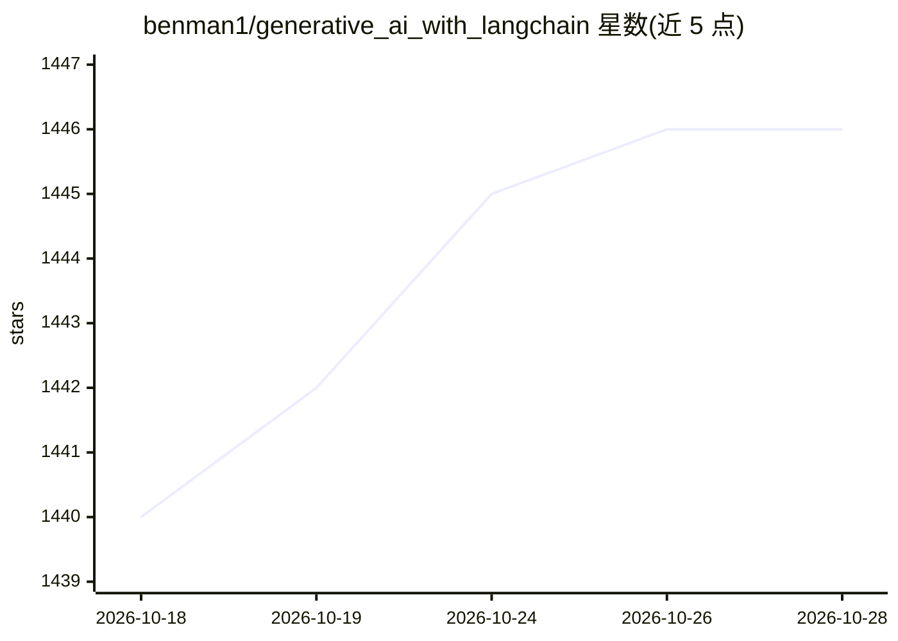

# benman1/generative_ai_with_langchain

⭐ 1,448 · Jupyter Notebook · MIT · 推送 2026-09-26 · [GitHub](https://github.com/benman1/generative_ai_with_langchain) · [官网](https://amzn.to/4dErkya) · 个人维护

**《Generative AI with LangChain》第二版书籍配套代码仓库**

Packt 出版书籍 Generative AI with LangChain (2nd Edition, 2025) 的官方代码配套仓库，作者为 Ben Auffarth 与 Leonid Kuligin。内容按 9 个章节目录组织，覆盖 LangGraph 工作流、多智能体系统、RAG、软件开发与数据分析智能体、评测与生产部署等示例脚本与 notebook。仓库维护 4 个分支对应不同书籍版本（v1 迁移至 LangChain v1.0、2nd edition、softupdate、main），Python 3.12+ 适用于 v1 分支。

## 筛选速览

| 维度 | 判定 | 备注 |
|---|---|---|
| AI 角色 | `ai-knowledge` | 知识聚合/清单类 |
| 许可风险 | `permissive` | MIT |
| 部署形态 | `None` |  |
| 模型依赖 | — | README 未给出锁定关系 |
| 硬件要求 | — | 无带数字的原话,不猜 |
| 安装摩擦 | `low` | 无编译、无系统依赖或容器化 |
| 成熟度 | — | 结构信号不足 |

## 能力要点

- 9 个章节目录组织示例脚本与 notebook
- 4 个分支对应不同版本书籍与 LangChain 版本
- v1 分支迁移至 LangChain v1.0 与 2026 模型标准（Python 3.12+）
- 可在 computing platforms 上执行仓库中的 notebooks

## 适用场景

- 随书学习 LangChain/LangGraph 构建 LLM 应用与智能体
- 获取多智能体、RAG、评测部署的实践代码示例
- 了解书籍章节结构与代码更新情况

## 场景标签

`教程课程` · 领域:学习与行业

## 证据(README 行号)

> L2:  This is the code repository for Generative AI with LangChain, Second Edition, published by Packt.
> L71: In the following table, you can find links to the directories in this repository. Each directory contains further l

## 星数曲线

2026-10-18 1,440 → 2026-10-28 1,446（+6）

---
*卡片 v1 · prompt 1.4 · 生成 2026-10-21 · 置信度 high · 依据 README sha `9218fea0bd41` · [字段定义](../../DATASET.md)*
