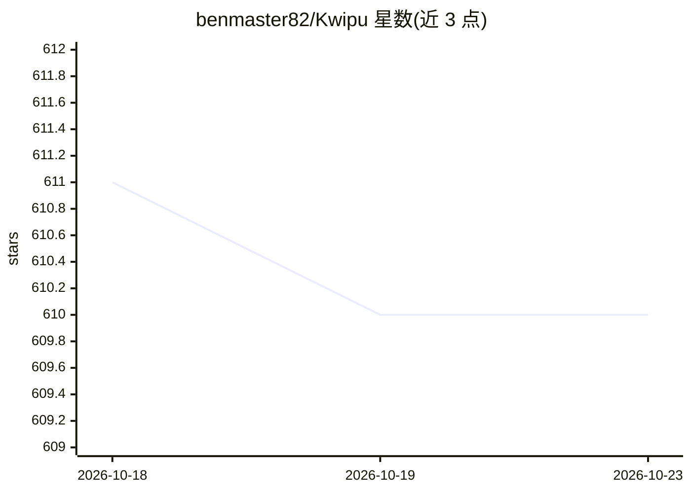

# benmaster82/Kwipu

⭐ 610 · Python · MIT · 推送 2026-10-22 · [GitHub](https://github.com/benmaster82/Kwipu) · 个人维护 · 中文 README

**对 Markdown 笔记做本地 Graph RAG 问答的工具，兼容 Obsidian**

把 .md/.txt/.pdf/.docx 文档构建为属性图索引，从 wikilink 与 YAML frontmatter 提取结构关系、用 LLM 提取语义关系，检索结合向量相似度、BM25 与时间元数据，回答附来源引文。面向使用 Obsidian 库或普通笔记文件夹的用户，提供终端界面、3D Web 界面与 MCP server 三种访问方式，并监听文件夹变化增量更新。需注意：默认 LLM 为 gpt-oss:20b-cloud（云端），完全本地需自选本地 Ollama 模型；安装需 Git/Python 3.12+/Ollama，Web 界面另需 Node.js。

## 筛选速览

| 维度 | 判定 | 备注 |
|---|---|---|
| AI 角色 | `ai-native` | 本体是模型或模型工具 |
| 许可风险 | `permissive` | MIT |
| 部署形态 | `library` | 以包/库形式分发 |
| 模型依赖 | local-ok | 支持本地模型 |
| 硬件要求 | — | 无带数字的原话,不猜 |
| 安装摩擦 | `low` | 无编译、无系统依赖或容器化 |
| 成熟度 | — | 结构信号不足 |

## 能力要点

- 从 wikilink 与 YAML frontmatter 提取实体-关系三元组建属性图
- 向量+BM25+时间元数据的混合检索，回答附引用
- 终端、Web API、MCP server 三种接口共享同一索引
- 监听文档变化并安全更新持久化存储

## 适用场景

- 在 Obsidian 笔记库上直接提问并得到带引用的回答
- 在浏览器 3D 图谱中探索实体、文档与关系
- 通过 MCP 客户端（如 Claude 类工具）查询自己的笔记
- 重建会议记录中的决策与项目时间线

## 场景标签

`RAG` `知识图谱` `文档问答` · 领域:知识与检索

## 证据(README 行号)

> L14: Kwipu turns a folder of documents into a property-graph RAG index that you can explore and query from an interactiv
> L31: - Builds a property graph from `.md`, `.txt`, `.pdf`, and `.docx` documents.
> L34: - Grounds answers in source chunks and returns citations.

## 星数曲线

2026-10-18 611 → 2026-10-23 610（-1）

---
*卡片 v1 · prompt 1.4 · 生成 2026-10-21 · 置信度 mid · 依据 README sha `f7360c85dca7` · [字段定义](../../DATASET.md)*
