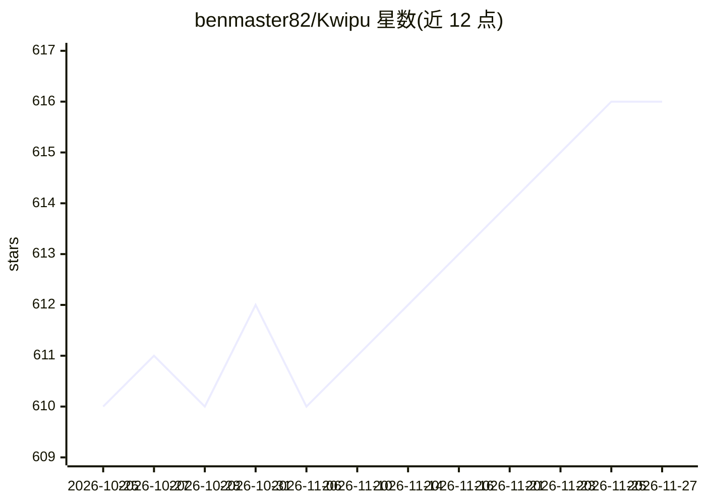

# benmaster82/Kwipu

⭐ 616 · Python · MIT · 推送 2026-11-20 · [GitHub](https://github.com/benmaster82/Kwipu) · [官网](https://benmaster82.github.io/Kwipu/) · 个人维护 · 中文 README

**本地 Graph RAG 引擎：对 Markdown 笔记提问并附引用**

将文档文件夹（含 Obsidian 库）构建为属性图 RAG 索引：从 wikilink 与 YAML frontmatter 提取结构关系，用 LLM 提取语义关系，检索融合向量相似、BM25 与时间元数据，回答附来源引用。提供终端、3D Web 界面与 MCP Server 三种使用途径，文件夹变动可被监视并增量更新。运行依赖 Python 3.12+ 与 Ollama；默认 LLM 为云端 gpt-oss:20b-cloud，会外发文档块与问题，需自行选择本地模型（如 qwen2.5:7b）实现全本地运行。支持英、意、法、德、西、葡六语言模式。

## 筛选速览

| 维度 | 判定 | 备注 |
|---|---|---|
| AI 角色 | `ai-native` | 本体是模型或模型工具 |
| 许可风险 | `permissive` | MIT |
| 部署形态 | `library` | 以包/库形式分发 |
| 模型依赖 | local-ok | 支持本地模型 |
| 硬件要求 | — | 无带数字的原话,不猜 |
| 安装摩擦 | `low` | 无编译、无系统依赖或容器化 |
| 成熟度 | — | 结构信号不足 |

## 能力要点

- 从 wikilink/YAML frontmatter 提取结构关系，LLM 提取语义关系并保留来源块引用
- 混合检索：向量相似 + BM25 + 时间元数据 + 可选同义词检索
- 终端、3D Web 界面与 MCP Server 暴露同一知识图谱
- 文件夹监视与持久化存储的安全增量更新

## 适用场景

- 在终端或浏览器里用自己的 Obsidian 笔记问答并溯源
- 跨会议/评审笔记重建项目时间线与决策
- 跨人、角色与文档比较并给出引用来源
- 通过 MCP 客户端接入自己的知识库

## 场景标签

`知识图谱` `RAG` `文档问答` · 领域:知识与检索

## 证据(README 行号)

> L15: Kwipu turns a folder of documents into a property-graph RAG index that you can explore and query from an interactiv
> L34: - Combines vector similarity, BM25, temporal metadata, and optional synonym retrieval.
> L35: - Grounds answers in source chunks and returns citations.

## 星数曲线

2026-10-25 610 → 2026-11-27 616（+6）

---
*卡片 v1 · prompt 1.4 · 生成 2026-11-25 · 置信度 high · 依据 README sha `ab2c433b056e` · [字段定义](../../DATASET.md)*
