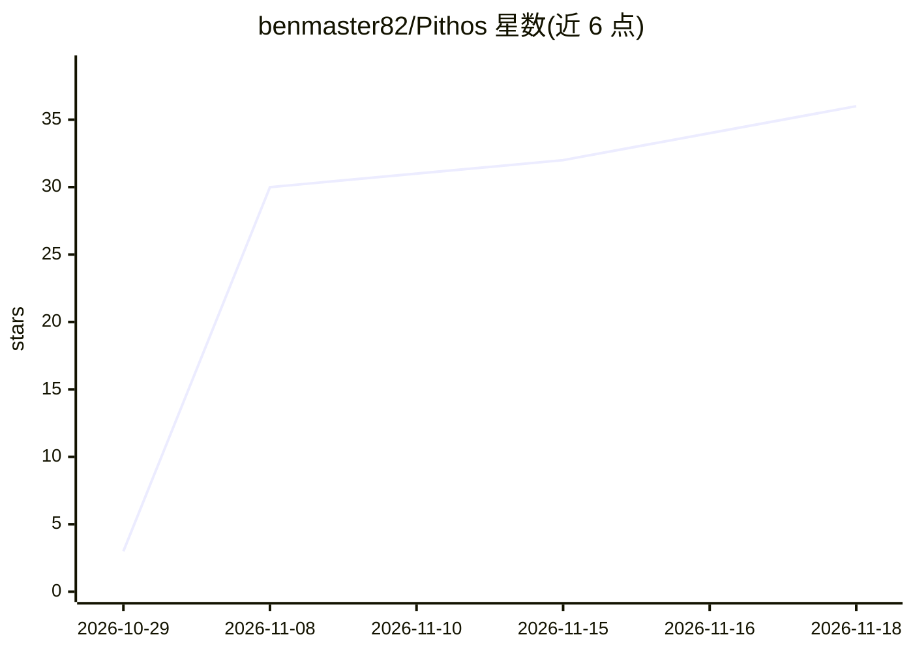

# benmaster82/Pithos

⭐ 36 · C · MIT · 推送 2026-11-15 · [GitHub](https://github.com/benmaster82/Pithos) · [官网](https://benmaster82.github.io/Pithos/) · 个人维护

**无依赖 C11 本地推理引擎，运行 Liquid AI LFM 系列模型**

用 C11 从零编写、构建期零外部依赖的本地推理引擎，读取 GGUF 格式的 LFM2 / LFM2.5 / LFM3 与 Qwen3.6（实验性）模型。单可执行文件内含终端聊天、OpenAI 兼容 HTTP 服务器、网页聊天 Agent（Pandora）与终端 Agent，另支持 LFM3-Audio-2B 的语音转录/翻译/合成。CPU 用 AVX2/AVX/NEON 整数内核，GPU 可选 OpenCL / Direct3D 12 / Vulkan 加速，可在 Xbox One 开发者模式运行。提供 Windows/Linux 预编译二进制，或用脚本从源码构建；部分模型与音频功能标注为实验性。

## 筛选速览

| 维度 | 判定 | 备注 |
|---|---|---|
| AI 角色 | `ai-ecosystem` | LLM/agent 周边工具 |
| 许可风险 | `permissive` | MIT |
| 部署形态 | `desktop` | 安装包/桌面程序 |
| 模型依赖 | — | README 未给出锁定关系 |
| 硬件要求 | `cpu-ok` | |
| 安装摩擦 | `high` | 编译与系统依赖俱全 |
| 成熟度 | `idea` | |

## 能力要点

- C11 编写、构建期零外部依赖，仅依赖操作系统 API（Win32/POSIX）
- 单可执行文件包含终端聊天、OpenAI 兼容服务器、网页 Agent（Pandora）与终端 Agent
- 可选 OpenCL / Direct3D 12 / Vulkan GPU 加速，`--gpu` 一项选择后端
- 支持大于空闲内存的模型（异步预读、专家预测，从磁盘流式加载）

## 适用场景

- 在普通笔记本上本地运行 LFM2.5-24B-A2B 等 GGUF 模型做对话
- 给局域网内设备提供 OpenAI 兼容的聊天与音频 API 服务器
- 用网页 Agent 或终端 Agent 执行 shell 命令、修代码、联网搜索

## 场景标签

`推理引擎` `聊天机器人` `语音识别` `语音合成` · 领域:对话与助手

## 证据(README 行号)

> L34: Pithos is an inference engine written from scratch in C11 with **no dependencies**: no external
> L60: - OpenAI-compatible HTTP server with prompt reuse across turns, also after a restart.

## 星数曲线

2026-10-29 3 → 2026-11-18 36（+33）

---
*卡片 v1 · prompt 1.4 · 生成 2026-11-18 · 置信度 mid · 依据 README sha `5add5eb08053` · [字段定义](../../DATASET.md)*
