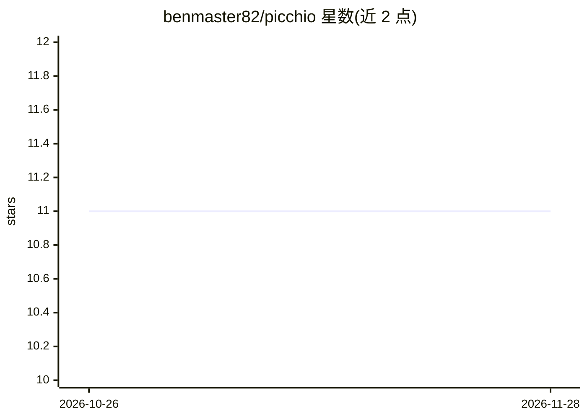

# benmaster82/picchio

⭐ 11 · C · MIT · 推送 2026-11-12 · [GitHub](https://github.com/benmaster82/picchio) · 个人维护

**在内存有限的普通硬件上以磁盘流式方式运行超大 MoE 模型的纯 C 推理引擎**

用纯 C 编写的流式 MoE 推理引擎：将模型常驻的小型 dense 部分留在内存，按 token 需求从磁盘流式读取专家权重并缓存，使超过物理内存的模型可在消费级硬件上运行（66 GB 模型在 16 GB 内存机器上运行）。支持 GPT-OSS 20B/120B、Qwen3-MoE、MiniMax-M2 三个模型族，提供模型格式转换脚本、chat 桥接、INT8 attention 与 INT3 专家压缩，并支持 LAN 上两台机器的分布式推理。Windows 提供 Release 预编译二进制，其余平台需从源码编译。作者声明多数代码路径仅在两台 Intel/Windows 笔记本上测过，ARM/部分 SIMD 路径未经实测。

## 筛选速览

| 维度 | 判定 | 备注 |
|---|---|---|
| AI 角色 | `ai-ecosystem` | LLM/agent 周边工具 |
| 许可风险 | `permissive` | MIT |
| 部署形态 | `desktop` | 安装包/桌面程序 |
| 模型依赖 | — | README 未给出锁定关系 |
| 硬件要求 | — | 无带数字的原话,不猜 |
| 安装摩擦 | `high` | 编译与系统依赖俱全 |
| 成熟度 | — | 结构信号不足 |

## 能力要点

- 按需从磁盘流式读取专家权重，可在 16 GB 内存上运行 66 GB 模型
- 支持 GPT-OSS、Qwen3-MoE、MiniMax-M2 三个 MoE 模型族
- INT8 attention（--dense-bits 8）与 INT3 专家打包降低磁盘 I/O
- 支持 LAN 两机分布式推理，仅残差流向量跨网络传输

## 适用场景

- 在没有数据中心 GPU 的普通笔记本上本地运行超大 MoE 模型
- 在受限网络或离线环境中部署本地大模型推理
- 在两台局域网机器上分担超大模型的推理负载

## 场景标签

`推理引擎` · 领域:训练与推理

## 证据(README 行号)

> L15: **A streaming Mixture-of-Experts (MoE) inference engine written in pure C, that
> L21: permanently in memory and **streams the experts from disk on demand**, caching

## 星数曲线

2026-10-26 11 → 2026-11-28 11（+0）

---
*卡片 v1 · prompt 1.4 · 生成 2026-11-18 · 置信度 mid · 依据 README sha `269d77966d93` · [字段定义](../../DATASET.md)*
