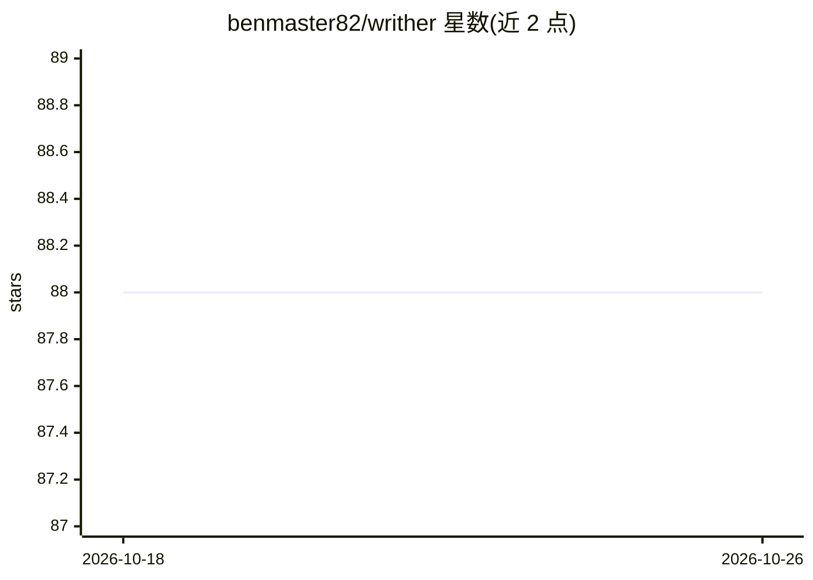

# benmaster82/writher

⭐ 88 · Python · MIT · 推送 2026-10-24 · [GitHub](https://github.com/benmaster82/writher) · [官网](https://getwrither.com/) · 个人维护

**Windows 离线语音听写与语音助手：全本地运行，无云无遥测**

常驻系统托盘的 Windows 桌面应用，提供两种热键模式：听写（faster-whisper 转写语音并粘贴到任意聚焦应用）与语音助手（通过本地 LLM 解析自然语言，管理笔记、待办、日程与提醒，存于本地 SQLite）。支持自定义词汇表、符号/拼写模式、语音删除确认、麦克风选择与多语言界面。语音识别用 faster-whisper，意图解析可接 Ollama 或 llama.cpp/LM Studio 等 OpenAI 兼容本地服务器，首次启动自动下载模型，之后完全离线。提供独立 exe，无需 Python。

## 筛选速览

| 维度 | 判定 | 备注 |
|---|---|---|
| AI 角色 | `ai-native` | 本体是模型或模型工具 |
| 许可风险 | `permissive` | MIT |
| 部署形态 | `desktop` | 安装包/桌面程序 |
| 模型依赖 | local-ok | 支持本地模型 |
| 硬件要求 | — | 无带数字的原话,不猜 |
| 安装摩擦 | `medium` | 含编译或系统依赖之一 |
| 成熟度 | — | 结构信号不足 |

## 能力要点

- 听写文本直接粘贴到任意聚焦应用，支持 hold/toggle 两种录音模式
- 语音助手经本地 LLM 管理笔记、待办、日程与提醒，数据存本地 SQLite
- 100% 本地：faster-whisper + Ollama/llama.cpp 等 OpenAI 兼容服务器，无云无遥测
- 自定义词汇表与符号拼写模式（说 'forward slash' 输出 /）

## 适用场景

- 在任意应用中免手打字听写文本
- 用语音记笔记、建购物清单、设日程提醒
- 在注重隐私、不允许云服务的环境下使用语音输入

## 场景标签

`语音识别` `知识库管理` · 领域:知识与检索

## 证据(README 行号)

> L65: |**Dictation**|`AltGr`|Transcribes your voice and pastes the text directly into whichever app has focus - editors, 
> L77: Everything runs **locally**: speech recognition via faster-whisper, intent parsing via Ollama or an OpenAI-compatib

## 星数曲线

2026-10-18 88 → 2026-10-26 88（+0）

---
*卡片 v1 · prompt 1.4 · 生成 2026-10-23 · 置信度 mid · 依据 README sha `5b3d5eae2eb1` · [字段定义](../../DATASET.md)*
