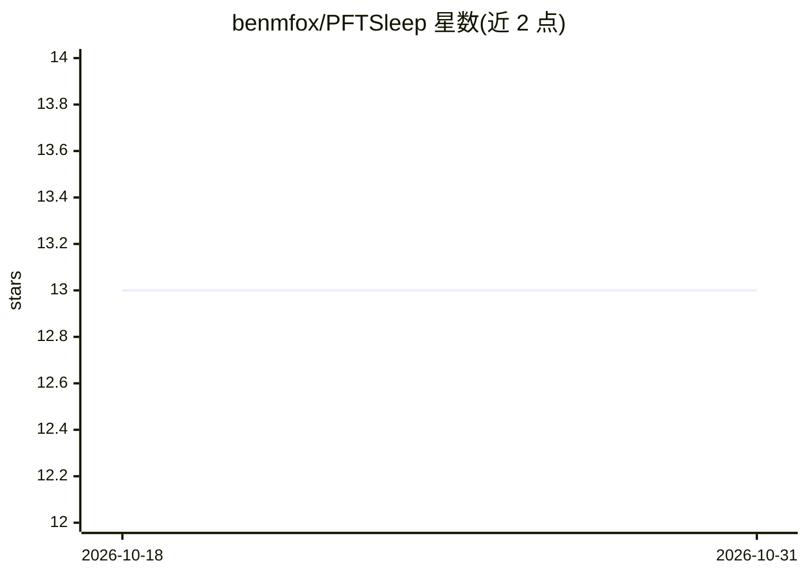

# benmfox/PFTSleep

⭐ 13 · Jupyter Notebook · Apache-2.0 · 推送 2026-07-14 · [GitHub](https://github.com/benmfox/PFTSleep) · [官网](https://benmfox.github.io/PFTSleep/) · 个人维护

**基于基础 Transformer 的整夜多导睡眠图睡眠分期分类 Python 包**

PFTSleep 提供预训练基础 Transformer 模型，对整夜多通道睡眠研究数据（EEG/EOG/EMG/ECG，需参考电极）进行睡眠分期：输入 EDF 文件，固定 8 小时窗口输出 960 个 30 秒 epoch 的五分类 logits（wake/N1/N2/N3/REM），可导出 HYPJSON 格式。模型权重托管在 Hugging Face（需申请访问权限），推理支持 CPU/GPU/MPS。面向睡眠研究人员与开发者，仓库基于 nbdev（Jupyter notebook 开发），另含 SHHS/MESA/MROS/WSC 等数据集处理脚本与基础模型、分类头的训练流程。限制：要求 8 小时输入，超出部分不预测；多 EDF 需通道命名一致。

## 筛选速览

| 维度 | 判定 | 备注 |
|---|---|---|
| AI 角色 | `ai-native` | 本体是模型或模型工具 |
| 许可风险 | `permissive` | Apache-2.0 |
| 部署形态 | `library` | 以包/库形式分发 |
| 模型依赖 | — | README 未给出锁定关系 |
| 硬件要求 | — | 无带数字的原话,不猜 |
| 安装摩擦 | `medium` | 含编译或系统依赖之一 |
| 成熟度 | — | 结构信号不足 |

## 能力要点

- 预训练基础 Transformer 直接输出五类睡眠分期预测
- 读取 EDF 文件，按 30 秒 epoch 输出 960 个分期 logits
- 模型权重经 Hugging Face 分发（需申请访问与 token）
- 推理设备支持 CPU/CUDA/MPS，附基础模型与分类头训练脚本

## 适用场景

- 对整夜多导睡眠记录 EDF 做自动睡眠分期
- 睡眠研究中批量生成 HYPJSON 分期结果
- 在自建睡眠数据集上继续训练基础模型与分类头

## 场景标签

 · 领域:医疗健康/睡眠医学

## 证据(README 行号)

> L5: PFTSleep is a Python package for sleep stage classification using a
> L6: pre-trained foundational transformer. The repository is built using
> L74: Prediction logits of shape \[bs x 5 x 960\] are outputted. The first
> L76: wake, 1 is N1, 2 is N2, 3 is N3, and 4 is REM. To retrieve

## 星数曲线

2026-10-18 13 → 2026-10-31 13（+0）

---
*卡片 v1 · prompt 1.4 · 生成 2026-10-31 · 置信度 high · 依据 README sha `70413f6ef6d7` · [字段定义](../../DATASET.md)*
