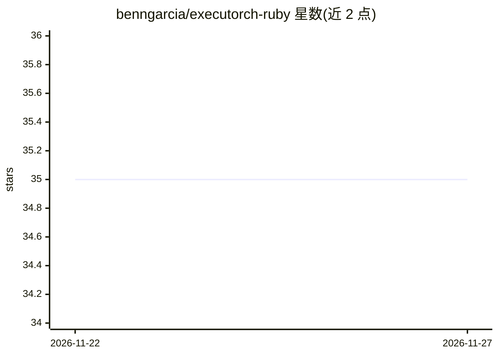

# benngarcia/executorch-ruby

⭐ 35 · C++ · Apache-2.0 · 推送 2026-11-21 · [GitHub](https://github.com/benngarcia/executorch-ruby) · [官网](https://rubygems.org/gems/executorch) · 个人维护

**在 Ruby 中运行 PyTorch ExecuTorch 模型的原生绑定**

基于 Ruby C API 直接编写的 ExecuTorch 1.6.0 原生绑定，用于在 Ruby 中加载并执行导出的 PyTorch 模型（.pte/.ptd）。提供预编译平台 gem（Linux x86_64/aarch64、macOS arm64），执行时释放 GVL 支持跨核并行，支持零拷贝 IO::Buffer 张量与 XNNPACK/CoreML/MLX 硬件委托，附 Numo::NArray 与 Torch::Tensor 适配器及类型化错误体系。要求 Ruby >= 3.2。

## 筛选速览

| 维度 | 判定 | 备注 |
|---|---|---|
| AI 角色 | `ai-native` | 本体是模型或模型工具 |
| 许可风险 | `permissive` | Apache-2.0 |
| 部署形态 | `None` |  |
| 模型依赖 | — | README 未给出锁定关系 |
| 硬件要求 | — | 无带数字的原话,不猜 |
| 安装摩擦 | `medium` | 含编译或系统依赖之一 |
| 成熟度 | — | 结构信号不足 |

## 能力要点

- 预编译 gem 覆盖 x86_64-linux、aarch64-linux、arm64-darwin 三平台
- 执行与加载释放 Ruby GVL，多 Module 实例跨核并行
- 零拷贝 IO::Buffer 输入与 out: 复用调用方缓冲区
- 硬件委托支持 XNNPACK、CoreML、MLX

## 适用场景

- 在 Ruby 应用（如 Puma/Unicorn 服务）中直接运行导出的 PyTorch 模型推理
- 在服务器多 worker 场景下并行执行模型并控制线程池大小
- 通过 Numo::NArray 或 Torch::Tensor 适配器在 Ruby 数值生态中传递张量

## 场景标签

`推理引擎` · 领域:训练与推理

## 证据(README 行号)

> L7: Native Ruby bindings for Meta's ExecuTorch runtime (`1.6.0`), built directly on the Ruby C API.
> L9: Run exported PyTorch models (`.pte` / `.ptd`) in Ruby with precompiled platform gems, GVL-free execution, zero-copy 
> L16: gem "executorch", "~> 1.0"

## 星数曲线

2026-11-22 35 → 2026-11-27 35（+0）

---
*卡片 v1 · prompt 1.4 · 生成 2026-11-22 · 置信度 high · 依据 README sha `8670f411450d` · [字段定义](../../DATASET.md)*
