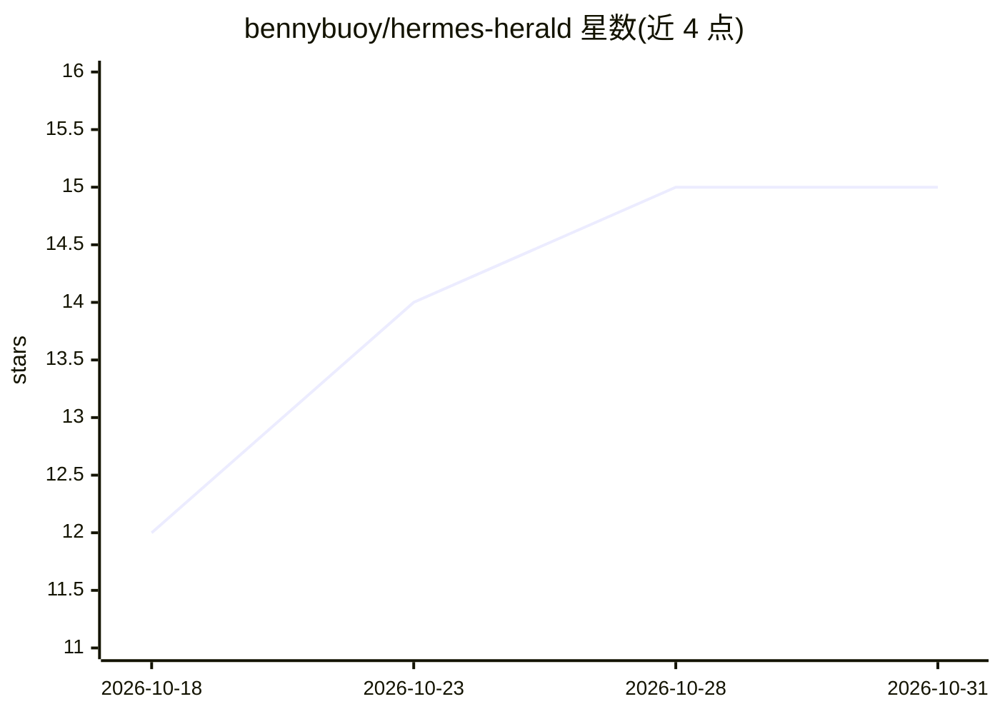

# bennybuoy/hermes-herald

⭐ 15 · Python · MIT · 推送 2026-10-17 · [GitHub](https://github.com/bennybuoy/hermes-herald) · 个人维护

**Hermes Agent 的多智能体派发与模型路由插件**

面向 Hermes Agent 用户的插件，将单个 agent 变为专家 agent 与模型的调度层：提供命名 agent 间对话（dispatch_chat）、向其他 Hermes profile 派发独立任务（dispatch_agent）、按任务生成带独立模型与身份的本地子 agent（delegate_subagent），以及无 agent 循环的轻量推理调用（llm_call/llm_direct）。模型路由采用 fail-closed 白名单，凭据由宿主持有。完整委托工作流要求 plugins.isolation: in_process，隔离宿主模式仅有实验性轮询适配器。通过 hermes 插件命令或 git clone 安装，含从 agent-dispatch 1.x 的迁移说明。

## 筛选速览

| 维度 | 判定 | 备注 |
|---|---|---|
| AI 角色 | `ai-ecosystem` | LLM/agent 周边工具 |
| 许可风险 | `permissive` | MIT |
| 部署形态 | `None` |  |
| 模型依赖 | — | README 未给出锁定关系 |
| 硬件要求 | — | 无带数字的原话,不猜 |
| 安装摩擦 | `low` | 无编译、无系统依赖或容器化 |
| 成熟度 | `idea` | |

## 能力要点

- 12 个工具：命名 profile 对话、跨 profile 任务派发、本地子 agent、轻量推理调用
- fail-closed 模型路由与经认证的模型目录发现
- 每个派发任务可单独选择子 agent 的模型、身份与工具
- SSE 自动完成投递与可选操作技能文档

## 适用场景

- 让协调 agent 并行派发代码、安全、文档审查给不同专家
- 为分类/抽取等高频任务用裸推理替代完整 agent 循环
- 通过 Tailscale 连接多台 Hermes 主机组成专家网络

## 场景标签

`多智能体` · 领域:Agent 开发

## 证据(README 行号)

> L12: Hermes Herald turns one Hermes Agent into a **conductor of specialist agents and models**. It adds three capabiliti
> L55: Herald is not a replacement for Hermes profiles or provider configuration. It is the **control plane between them**

## 星数曲线

2026-10-18 12 → 2026-10-31 15（+3）

---
*卡片 v1 · prompt 1.4 · 生成 2026-10-31 · 置信度 high · 依据 README sha `6a427622e0c9` · [字段定义](../../DATASET.md)*
