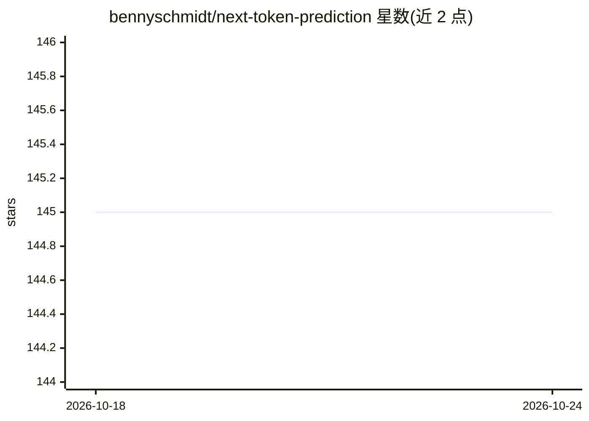

# bennyschmidt/next-token-prediction

⭐ 145 · JavaScript · 推送 2026-10-04 · [GitHub](https://github.com/bennyschmidt/next-token-prediction) · 个人维护

**JavaScript next-token 预测库：从文本构建 n-gram 语言模型**

以 npm 包形式提供的 JavaScript 库：读取 /training/ 目录下的 .txt 文件训练 n-gram/马尔可夫链语言模型，输出下一个词、短语或像素的预测；也可使用仓库内置的已提交训练数据跳过训练。面向需要在应用中加入自动补全、自动纠错、拼写检查、搜索等文本预测功能的开发者；目标中列出计划扩展图像与音频预测格式，并提供 readline 补全与 UI 自动补全示例及浏览器快速补全演示。

## 筛选速览

| 维度 | 判定 | 备注 |
|---|---|---|
| AI 角色 | `ai-native` | 本体是模型或模型工具 |
| 许可风险 | `none` | — |
| 部署形态 | `library` | 以包/库形式分发 |
| 模型依赖 | — | README 未给出锁定关系 |
| 硬件要求 | — | 无带数字的原话,不猜 |
| 安装摩擦 | `low` | 无编译、无系统依赖或容器化 |
| 成熟度 | — | 结构信号不足 |

## 能力要点

- 基于文本训练 next-token 预测模型（下一个词/短语/像素）
- 可使用仓库内置训练数据跳过训练步骤
- 提供 readline 补全与 UI 自动补全示例

## 适用场景

- 在 Web 或 Node 应用中添加快速文本自动补全
- 用自己的文本语料训练轻量语言模型做预测
- 实验 n-gram/马尔可夫链文本预测方法

## 场景标签

 · 领域:NLP/工具库

## 证据(README 行号)

> L3: Create a language model based on a body of text and get high-quality predictions (next word, next phrase, next pixel
> L70: 1. Provide a high-quality text prediction library for:

## 星数曲线

2026-10-18 145 → 2026-10-24 145（+0）

---
*卡片 v1 · prompt 1.4 · 生成 2026-10-22 · 置信度 high · 依据 README sha `f6704c3fc3d2` · [字段定义](../../DATASET.md)*
