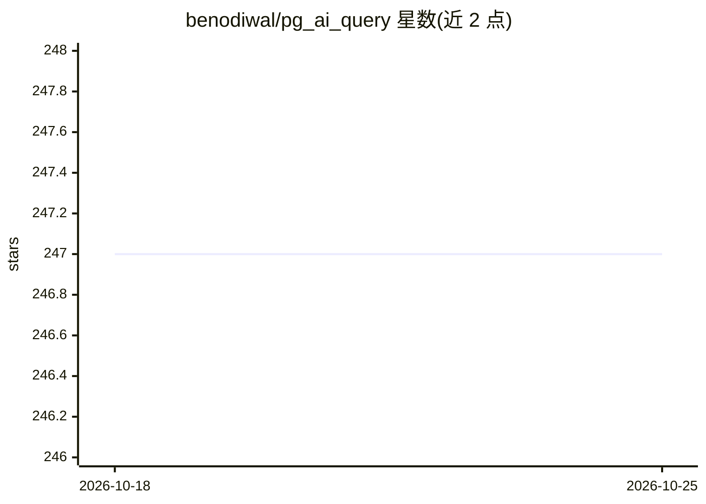

# benodiwal/pg_ai_query

⭐ 247 · C++ · Apache-2.0 · 推送 2026-06-01 · [GitHub](https://github.com/benodiwal/pg_ai_query) · [官网](https://benodiwal.github.io/pg_ai_query/) · 个人维护

**PostgreSQL 扩展：自然语言生成 SQL 并做查询性能分析**

C++ 编写的 PostgreSQL 扩展，提供 generate_query 与 explain_query 函数：前者将英文描述转为 SQL（自动发现库表结构、生成 JOIN/WHERE/LIMIT），后者运行 EXPLAIN ANALYZE 并输出 AI 生成的性能洞察。支持 OpenAI、Anthropic、Gemini 三家模型，API key 与模型选择通过 ~/.pg_ai.config 配置。内置安全机制：屏蔽系统表访问、仅操作用户表、强制行数限制。需从源码编译安装，要求 PostgreSQL 14+、CMake 3.16+ 与 C++20 编译器。

## 筛选速览

| 维度 | 判定 | 备注 |
|---|---|---|
| AI 角色 | `ai-native` | 本体是模型或模型工具 |
| 许可风险 | `permissive` | Apache-2.0 |
| 部署形态 | `None` |  |
| 模型依赖 | — | README 未给出锁定关系 |
| 硬件要求 | — | 无带数字的原话,不猜 |
| 安装摩擦 | `medium` | 含编译或系统依赖之一 |
| 成熟度 | — | 结构信号不足 |

## 能力要点

- 自然语言转 PostgreSQL SQL，自动分析库表结构
- explain_query 运行 EXPLAIN ANALYZE 并输出 AI 性能分析
- 支持 OpenAI / Anthropic / Gemini 模型，响应可选纯 SQL / 带解释 / JSON 三种格式
- 内置安全防护：屏蔽 information_schema 与 pg_catalog 访问、强制行数限制

## 适用场景

- 不会写 SQL 的用户直接用英文查询数据库
- 开发或 DBA 借助 AI 分析查询执行计划并获得优化建议
- 在现有 PostgreSQL 库内以扩展形式引入自然语言查询能力

## 场景标签

`数据分析` · 领域:效率与自动化

## 证据(README 行号)

> L3: A powerful PostgreSQL extension that generates SQL queries from natural language using state-of-the-art AI models fr
> L7: - **Natural Language to SQL**: Convert plain English descriptions into valid PostgreSQL queries

## 星数曲线

2026-10-18 247 → 2026-10-25 247（+0）

---
*卡片 v1 · prompt 1.4 · 生成 2026-10-22 · 置信度 high · 依据 README sha `00d6f8f2f4b2` · [字段定义](../../DATASET.md)*
