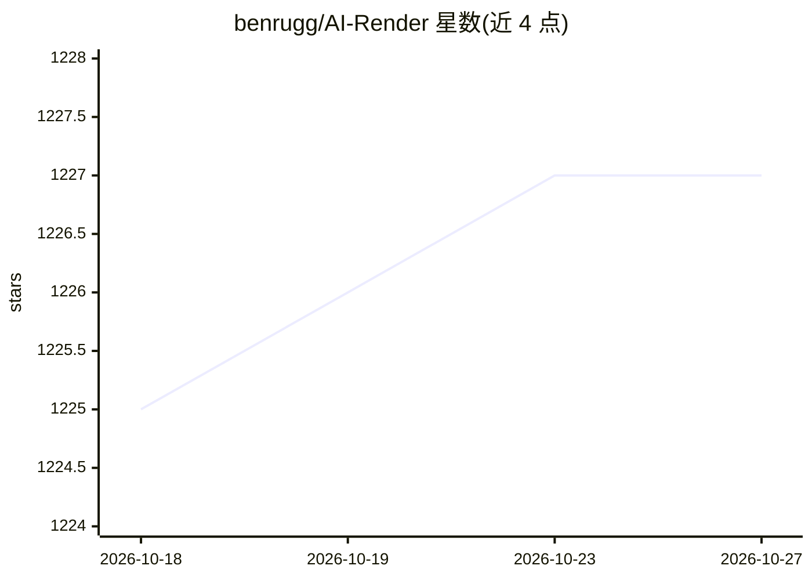

# benrugg/AI-Render

⭐ 1,227 · Python · MIT · 推送 2025-12-28 · [GitHub](https://github.com/benrugg/AI-Render) · 个人维护

**Blender 插件：在 Blender 内用 Stable Diffusion 生成 AI 图像**

Blender 附加组件，根据文本提示词与场景内容生成 Stable Diffusion 图像渲染。默认无需在本机运行代码即可使用（云端渲染），也可通过 Automatic1111 Stable Diffusion Web UI 在本地运行 Stable Diffusion。支持 Windows、Mac、Linux，要求 Blender 3.0.0+。支持渲染动画，可对 Stable Diffusion 设置与提示词文本做动画，并可用于批量处理多种设置或提示词。通过 Blender Market、Gumroad 获取，或从 releases 页面免费下载 zip 后在 Blender 中安装。

## 筛选速览

| 维度 | 判定 | 备注 |
|---|---|---|
| AI 角色 | `ai-native` | 本体是模型或模型工具 |
| 许可风险 | `permissive` | MIT |
| 部署形态 | `desktop` | 安装包/桌面程序 |
| 模型依赖 | — | README 未给出锁定关系 |
| 硬件要求 | — | 无带数字的原话,不猜 |
| 安装摩擦 | `low` | 无编译、无系统依赖或容器化 |
| 成熟度 | — | 结构信号不足 |

## 能力要点

- 基于提示词与场景生成 Stable Diffusion 图像
- 支持通过 Automatic1111 Web UI 本地运行 Stable Diffusion
- 支持动画渲染，可动画化 Stable Diffusion 设置与提示词
- 默认无需在本机运行代码

## 适用场景

- 在 Blender 工作流中直接生成 AI 图像渲染
- 用动画工具批量尝试不同提示词与设置
- 为场景快速生成风格化概念图

## 场景标签

`图像生成` · 领域:内容生成

## 证据(README 行号)

> L3: Render with Stable Diffusion in Blender. This add-on renders an AI generated image based on a text prompt and your s
> L5: Create incredible AI generated images with Stable Diffusion easily, without running any code on your own computer!

## 星数曲线

2026-10-18 1,225 → 2026-10-27 1,227（+2）

---
*卡片 v1 · prompt 1.4 · 生成 2026-10-21 · 置信度 high · 依据 README sha `42ba76008a43` · [字段定义](../../DATASET.md)*
