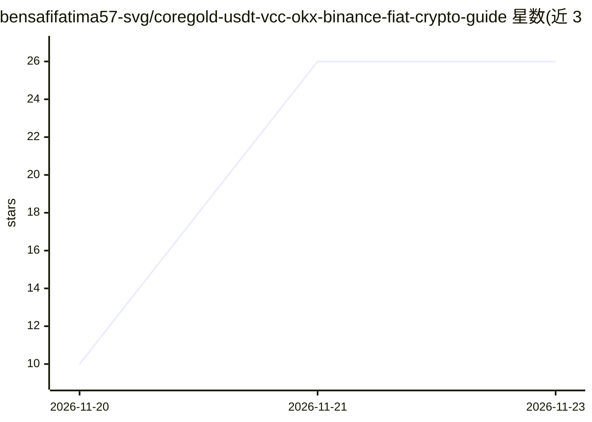

# bensafifatima57-svg/coregold-usdt-vcc-okx-binance-fiat-crypto-guide

⭐ 26 · 推送 2026-11-19 · [GitHub](https://github.com/bensafifatima57-svg/coregold-usdt-vcc-okx-binance-fiat-crypto-guide) · 个人维护 · 中文 README

**面向新手的 USDT 买币与 CoreGold 充值操作教程**

一份图文式操作手册，描述从 OKX 或币安 C2C 快捷买币（支付宝/微信支付）、链上提币选择 TRON (TRC20) 网络、到充值至 CoreGold 后台钱包并申请美区虚拟卡的三步流程。目标读者为无加密货币操作经验的用户，场景是为海外 AI 工具付费做准备。全文为步骤说明，不含代码、安装命令或 API。

## 筛选速览

| 维度 | 判定 | 备注 |
|---|---|---|
| AI 角色 | `ai-knowledge` | 知识聚合/清单类 |
| 许可风险 | `none` | — |
| 部署形态 | `None` |  |
| 模型依赖 | — | README 未给出锁定关系 |
| 硬件要求 | — | 无带数字的原话,不猜 |
| 安装摩擦 | `low` | 无编译、无系统依赖或容器化 |
| 成熟度 | — | 结构信号不足 |

## 能力要点

- 覆盖 OKX/币安 C2C 快捷买币的注册与付款步骤
- 说明 TRC20 网络提币操作与费用/到账特征
- 描述 CoreGold 后台充值与申请虚拟卡流程

## 适用场景

- 第一次用支付宝买 USDT 充值 CoreGold 开虚拟卡
- 为订阅海外 AI 工具准备加密支付渠道

## 场景标签

`教程课程` · 领域:学习与行业

## 证据(README 行号)

> L2: 纯小白必看的 USDT 入金实操手册：手把手教你如何通过 OKX 或币安（Binance）使用支付宝/微信快捷买币，并通过 TRC20 网络零手续费充入 CoreGold 后台。
> L7: 今天这篇极简小白文，带你从零开始打通从交易所买币到 CoreGold 开卡 的全套闭环。

## 星数曲线

2026-11-20 10 → 2026-11-23 26（+16）

---
*卡片 v1 · prompt 1.4 · 生成 2026-11-20 · 置信度 high · 依据 README sha `1910045e66bb` · [字段定义](../../DATASET.md)*
