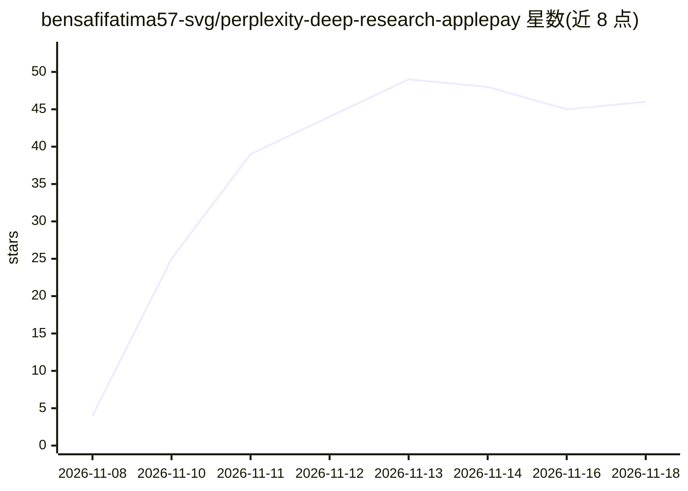

# bensafifatima57-svg/perplexity-deep-research-applepay

⭐ 46 · 推送 2026-11-06 · [GitHub](https://github.com/bensafifatima57-svg/perplexity-deep-research-applepay) · [官网](https://app.coregold.io/signup?invite_code=ADvlj9b) · 个人维护 · 中文 README

**推广 CoreGold 虚拟卡以开通 Perplexity Pro 的支付指南**

仓库内容为一份图文指南而非可运行软件：解释 Perplexity 经 Stripe Radar 的拒付原因（发卡行属地降权、AVS 数据断层、预授权验资），随后给出两条开通路径——网页端用 CoreGold 商业卡段直绑，或将该卡导入 Apple 钱包经 Secure Element 签名扣费；步骤均指向充值 USDT 并在 CoreGold 控制台开卡。README 末尾附开卡入口标识。无代码、无安装与运行说明。

## 筛选速览

| 维度 | 判定 | 备注 |
|---|---|---|
| AI 角色 | `ai-knowledge` | 知识聚合/清单类 |
| 许可风险 | `none` | — |
| 部署形态 | `None` |  |
| 模型依赖 | — | README 未给出锁定关系 |
| 硬件要求 | — | 无带数字的原话,不猜 |
| 安装摩擦 | `low` | 无编译、无系统依赖或容器化 |
| 成熟度 | — | 结构信号不足 |

## 能力要点

- 内容为支付避坑指南，不含可运行代码
- 分析 Stripe Radar / AVS / 预授权三类拒付原因
- 给出网页直绑与 Apple Pay 两条支付通道步骤
- 步骤依赖第三方 CoreGold 卡服务并附推广入口

## 适用场景

- 了解 Perplexity 订阅支付被拒的风控机制
- 按指南使用 CoreGold 卡开通 Pro 订阅（仓库自身推荐路径）

## 场景标签

 · 领域:支付/订阅指南

## 证据(README 行号)

> L2: Perplexity Pro 与 Deep Research 订阅防拒：支持 Apple Pay 硬件级签名与网页双通道，告别 Stripe 拒付与封号。
> L41: 👉 **立即进入 CoreGold 开卡控制台**

## 星数曲线

2026-11-08 4 → 2026-11-18 46（+42）

---
*卡片 v1 · prompt 1.4 · 生成 2026-11-18 · 置信度 low · 依据 README sha `acf0bfe014b0` · [字段定义](../../DATASET.md)*
