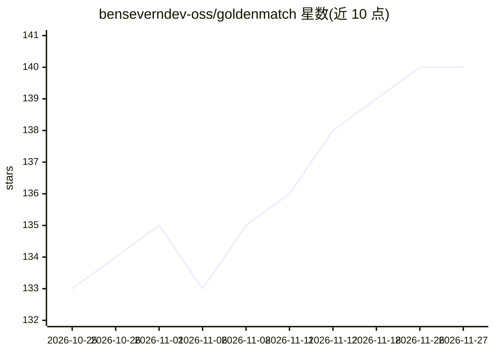

# benseverndev-oss/goldenmatch

⭐ 140 · Python · MIT · 推送 2026-11-26 · [GitHub](https://github.com/benseverndev-oss/goldenmatch) · [官网](https://docs.bensevern.dev/) · 个人维护

**为数据团队提供零配置实体解析，生成可审计的黄金记录**

Python/TypeScript/SQL 多接口的实体解析库：对 CSV 或表数据自动选择匹配规则，将重复记录合并为带稳定 entity_id、字段级溯源、merge/split 与防篡改审计日志的黄金实体。含 Fellegi-Sunter/LLM 评分器、自愈配置建议、Bloom-filter 隐私记录链接；核心为 Arrow 原生 Rust 引擎，默认 SQLite、可选 Postgres 持久化，宣称 250M 行规模可运行。自述部分较新的功能仍在落地中。

## 筛选速览

| 维度 | 判定 | 备注 |
|---|---|---|
| AI 角色 | `ai-enhanced` | 去掉 AI 部分产品仍成立 |
| 许可风险 | `permissive` | MIT |
| 部署形态 | `self-host` | docker 或自建部署 |
| 模型依赖 | — | README 未给出锁定关系 |
| 硬件要求 | — | 无带数字的原话,不猜 |
| 安装摩擦 | `low` | 无编译、无系统依赖或容器化 |
| 成熟度 | `idea` | |

## 能力要点

- 零配置去重：自动画像、选规则并返回可检视的 result.config
- 黄金实体层：稳定 UUIDv7 entity_id、逐字段溯源、merge/split 与哈希链审计日志
- 可选 Fellegi-Sunter 与 LLM 评分器，含 Bloom-filter PPRL 隐私链接
- Python、TypeScript/WASM、Postgres/DuckDB SQL、70+ MCP 工具多面呈现

## 适用场景

- 清洗 CRM、账单与表格中重复的客户记录
- 为下游系统提供跨数据源稳定的客户唯一标识
- 跨机构间不共享原始数据的隐私记录匹配
- 从 PDF/图片提取记录后统一做实体解析

## 场景标签

`知识图谱` · 领域:知识与检索

## 证据(README 行号)

> L5: Zero-config entity resolution for Python. Point it at a CSV or a table: it chooses how to match, shows you what it c
> L90: **Splink-beating entity resolution, Arrow-native and Rust-fast with zero tuning, feeding a durable identity layer s
> L94: **Python · TypeScript · SQL, at 4-decimal parity · native in Postgres + DuckDB · edge WASM · 70+ MCP tools · beats 

## 星数曲线

2026-10-25 133 → 2026-11-27 140（+7）

---
*卡片 v1 · prompt 1.4 · 生成 2026-11-27 · 置信度 mid · 依据 README sha `3ca19bfc62bc` · [字段定义](../../DATASET.md)*
