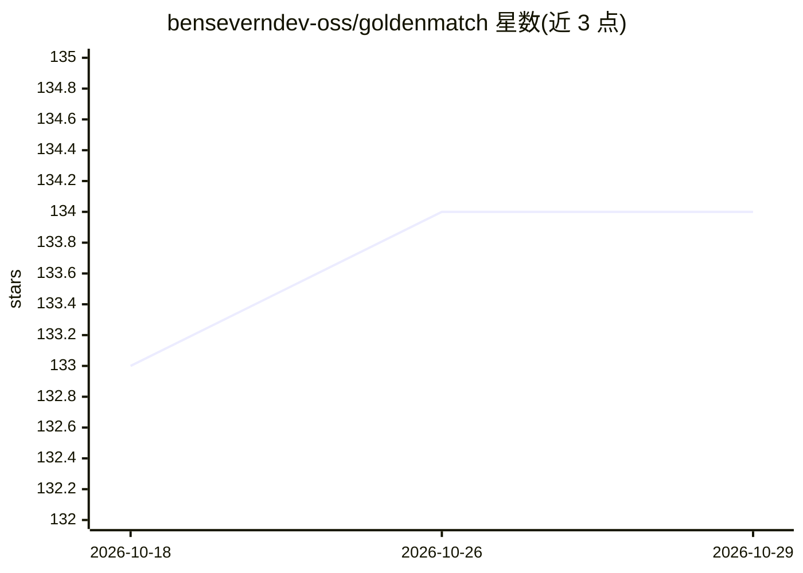

# benseverndev-oss/goldenmatch

⭐ 134 · Python · MIT · 推送 2026-10-28 · [GitHub](https://github.com/benseverndev-oss/goldenmatch) · [官网](https://docs.bensevern.dev/) · 个人维护

**零配置实体消解工具：把杂乱记录合并为带溯源的金色实体**

面向 Python/TypeScript/SQL 的实体消解（entity resolution）库：指向 CSV 或表，自动画像数据并选择匹配策略（精确/模糊/Fellegi-Sunter 概率/可选 LLM 评分），把重复记录合并为携带稳定 entity_id、逐字段溯源、merge/split 与哈希链审计日志的持久身份层，并提供 customer_360() 聚合读取。Arrow 原生、Rust 内核，宣称 250M 行 11.2 分钟。面向数据工程/平台工程师，需付费的 LLM 评分仅在显式开启时调用。

## 筛选速览

| 维度 | 判定 | 备注 |
|---|---|---|
| AI 角色 | `ai-enhanced` | 去掉 AI 部分产品仍成立 |
| 许可风险 | `permissive` | MIT |
| 部署形态 | `self-host` | docker 或自建部署 |
| 模型依赖 | — | README 未给出锁定关系 |
| 硬件要求 | — | 无带数字的原话,不猜 |
| 安装摩擦 | `low` | 无编译、无系统依赖或容器化 |
| 成熟度 | `idea` | |

## 能力要点

- 零配置自动选择匹配策略，config 可检视、复用与覆盖
- 稳定 entity_id + 逐字段溯源 + append-only 审计链
- 支持 Python/TypeScript(WASM)/Postgres/DuckDB/MCP 多接口，按一致性规范对齐
- 可选 Fellegi-Sunter 概率引擎与 Bloom-filter 隐私保护跨组织连接

## 适用场景

- CRM、账单、表格等多源客户数据去重，回答到底有多少客户
- 建立可持续更新的 Customer 360 身份层并保留字段级溯源
- 跨组织在不共享原始数据的前提下做记录连接

## 场景标签

 · 领域:数据工程/主数据管理

## 证据(README 行号)

> L5: Zero-config entity resolution for Python. Point it at a CSV or a table: it chooses how to match, shows you what it c
> L153: - **Beats the expert, out of the box.** On messy customer records, the opt-in Fellegi-Sunter engine beats hand-tun

## 星数曲线

2026-10-18 133 → 2026-10-29 134（+1）

---
*卡片 v1 · prompt 1.4 · 生成 2026-10-23 · 置信度 high · 依据 README sha `2944a920033f` · [字段定义](../../DATASET.md)*
