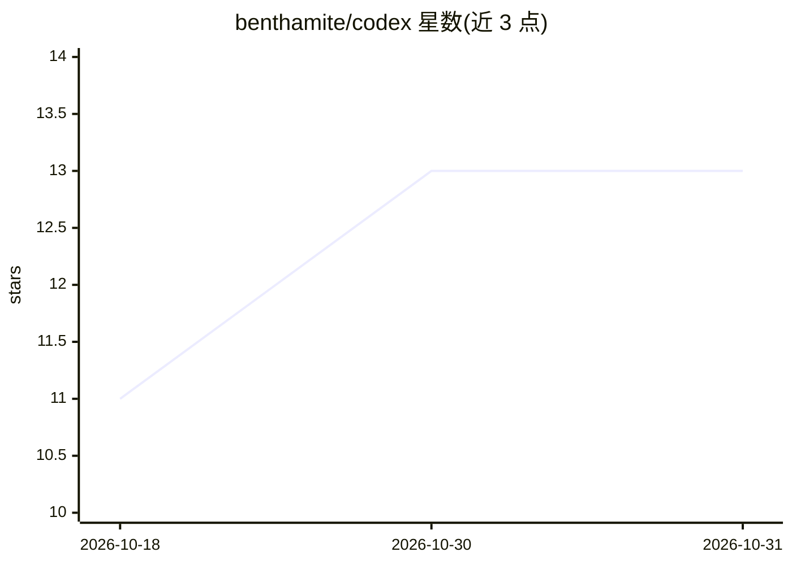

# benthamite/codex

⭐ 13 · Emacs Lisp · 推送 2026-10-07 · [GitHub](https://github.com/benthamite/codex) · [官网](https://stafforini.com/notes/codex/) · 个人维护

**在 Emacs 内运行 OpenAI Codex CLI 的集成包**

Emacs Lisp 包，封装 OpenAI Codex CLI 的编辑器内界面：通过 eat 终端（默认）、app-server 原生渲染或可选 vterm 运行 Codex，支持会话管理（启动/恢复/fork/多实例）、发送提示词与文件/行/区域/图片上下文、TUI 键序列交互、窗口缓冲管理、钩子通知与 transient 菜单，可运行时切换模型、推理力度、沙箱模式等。架构仿照 claude-code.el。要求 Emacs 28.1+，Codex CLI 须在 PATH 中，提供 package-vc/Elpaca/straight.el 三种安装方式。

## 筛选速览

| 维度 | 判定 | 备注 |
|---|---|---|
| AI 角色 | `ai-ecosystem` | LLM/agent 周边工具 |
| 许可风险 | `none` | — |
| 部署形态 | `None` |  |
| 模型依赖 | — | README 未给出锁定关系 |
| 硬件要求 | — | 无带数字的原话,不猜 |
| 安装摩擦 | `low` | 无编译、无系统依赖或容器化 |
| 成熟度 | — | 结构信号不足 |

## 能力要点

- 会话管理：启动、恢复、fork、多命名实例运行与批量终止
- 发送自由提示词及文件/行上下文、活动区域、整个缓冲区、图片与 error-at-point 请求
- 三种终端后端：eat 默认、app-server 原生渲染、可选 vterm
- 运行时切换模型、推理力度、沙箱模式、审批策略与 profile

## 适用场景

- 在 Emacs 中直接使用 Codex CLI 编码，无需切换终端
- 跨项目并行管理多个 Codex 会话
- 将选中代码区域或报错直接发给 Codex 处理

## 场景标签

`编码 Agent` · 领域:编码与开发

## 证据(README 行号)

> L3: `codex.el` provides an Emacs interface to the OpenAI Codex CLI, running Codex through the native app-server renderer
> L5: The package uses eat by default, can render natively through `app-server`, and can use vterm if you install it separ

## 星数曲线

2026-10-18 11 → 2026-10-31 13（+2）

---
*卡片 v1 · prompt 1.4 · 生成 2026-10-31 · 置信度 high · 依据 README sha `1ea66d2f1803` · [字段定义](../../DATASET.md)*
