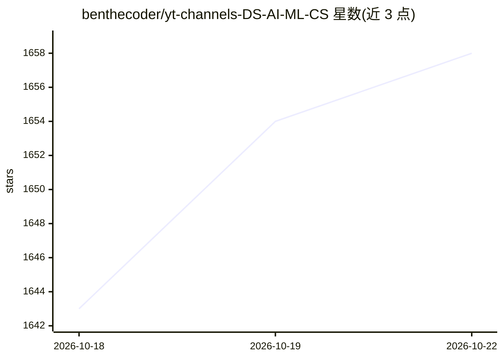

# benthecoder/yt-channels-DS-AI-ML-CS

⭐ 1,668 · 推送 2026-07-19 · [GitHub](https://github.com/benthecoder/yt-channels-DS-AI-ML-CS) · [官网](https://benthecoder.github.io/yt-channels-DS-AI-ML-CS/) · 个人维护

**数据科学与 AI 学习类 YouTube 频道清单（180+）**

一个 awesome 风格的策展清单，收录 180 余个 YouTube 频道，按数据科学/数据分析、ML/AI/DL、数据工程、统计数学、AI 研究、计算机科学与编程语言、Web 开发、软件工程、音频编程、播客、机构等主题分类组织。面向数据科学与编程学习者，通过社区 pull request 持续补充条目。清单本身不提供软件、数据集或安装方式，仅作导航用途。

## 筛选速览

| 维度 | 判定 | 备注 |
|---|---|---|
| AI 角色 | `ai-knowledge` | 知识聚合/清单类 |
| 许可风险 | `none` | — |
| 部署形态 | `None` |  |
| 模型依赖 | — | README 未给出锁定关系 |
| 硬件要求 | — | 无带数字的原话,不猜 |
| 安装摩擦 | `medium` | 含编译或系统依赖之一 |
| 成熟度 | — | 结构信号不足 |

## 能力要点

- 收录 180+ 个 YouTube 频道
- 覆盖数据科学、ML/AI/DL、数据工程、统计、编程等十余个分类
- 通过 pull request 社区维护，条目持续扩充

## 适用场景

- 寻找数据科学或机器学习方向的优质视频学习资源
- 按编程语言（Python/R/C++/Julia 等）查找教学频道
- 发现数据科学与 AI 主题的播客和机构频道

## 场景标签

`精选清单` · 领域:学习与行业

## 证据(README 行号)

> L5: A comprehensive list of +180 YouTube Channels (in no particular order) for Data Science, Data Engineering, Machine L

## 星数曲线

2026-10-18 1,643 → 2026-10-22 1,658（+15）

---
*卡片 v1 · prompt 1.4 · 生成 2026-10-21 · 置信度 high · 依据 README sha `6efef7f01a46` · [字段定义](../../DATASET.md)*
