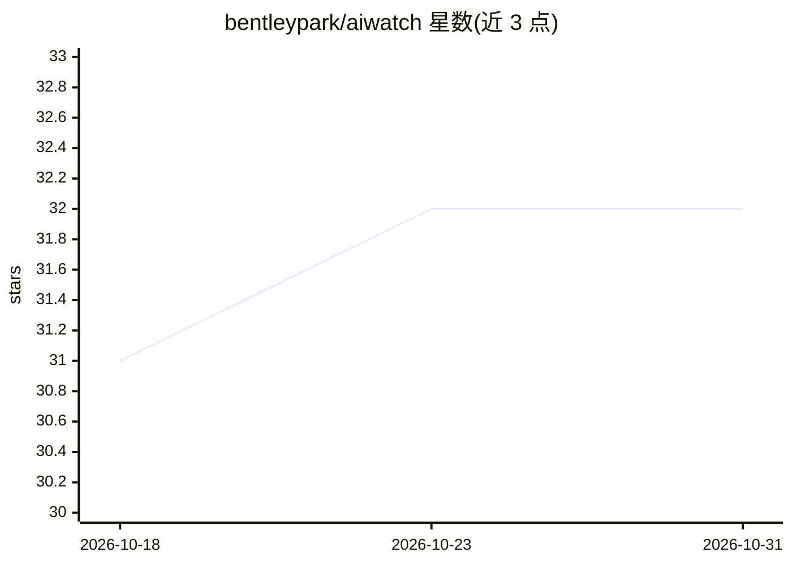

# bentleypark/aiwatch

⭐ 32 · TypeScript · AGPL-3.0 · 推送 2026-10-30 · [GitHub](https://github.com/bentleypark/aiwatch) · [官网](https://ai-watch.dev/) · 个人维护

**48 个 AI 服务的实时状态监控面板与可靠性排行**

面向依赖 AI 服务状态信息的开发者：通过 Cloudflare Workers 每 5 分钟采集 48 个 AI 服务（LLM API、编码代理、语音、推理基础设施等 8 类）的状态页数据与 36 个端点的直接 RTT 探测，展示实时状态、延迟趋势、30 天加权可用率（由 AIWatch 依据各服务商公开记录自行计算）、事件时间线与 AIWatch Score 综合可靠性评分。附带 Discord/Slack/RSS 告警、状态徽章、公开 API（限速 60 req/min）、Chrome 扩展与 Claude Code 插件（Beta）。前端 React 19 + Vite，后端 Cloudflare Workers，需 Node.js 20+ 与 Cloudflare 账号从源码运行。

## 筛选速览

| 维度 | 判定 | 备注 |
|---|---|---|
| AI 角色 | `ai-ecosystem` | LLM/agent 周边工具 |
| 许可风险 | `viral` | AGPL-3.0 |
| 部署形态 | `library` | 以包/库形式分发 |
| 模型依赖 | — | README 未给出锁定关系 |
| 硬件要求 | — | 无带数字的原话,不猜 |
| 安装摩擦 | `low` | 无编译、无系统依赖或容器化 |
| 成熟度 | `idea` | |

## 能力要点

- 48 个 AI 服务的实时状态/延迟/事件监控，36 个端点直接 RTT 探测
- 30 天加权可用率由 AIWatch 自行计算，另有 AIWatch Score 综合可靠性评分
- Discord/Slack/RSS 告警与 RTT 退化检测、状态页交叉验证防误报
- 公开 API、SVG 状态徽章、Chrome 扩展与 Claude Code 插件（Beta）

## 适用场景

- 依赖多家 AI API 的开发者在故障时快速确认上游服务是否宕机
- 在团队 Discord/Slack 中接收 AI 服务状态变更告警
- 在 README 或文档中嵌入 AI 服务实时状态徽章
- 通过公开 API 将 AI 服务状态接入自有工具

## 场景标签

 · 领域:AI 服务监控/可观测性

## 证据(README 行号)

> L16: Real-time monitoring dashboard for **48 AI services** — track status, latency, uptime, and incidents across major A
> L41: - **Uptime** — 30-day uptime **computed by AIWatch** from each provider's own published records, rather than copied
> L50: - **AIWatch Score** — Composite reliability score combining uptime, incidents, recovery time, and probe-based respo

## 星数曲线

2026-10-18 31 → 2026-10-31 32（+1）

---
*卡片 v1 · prompt 1.4 · 生成 2026-10-26 · 置信度 mid · 依据 README sha `57f51fc043ec` · [字段定义](../../DATASET.md)*
