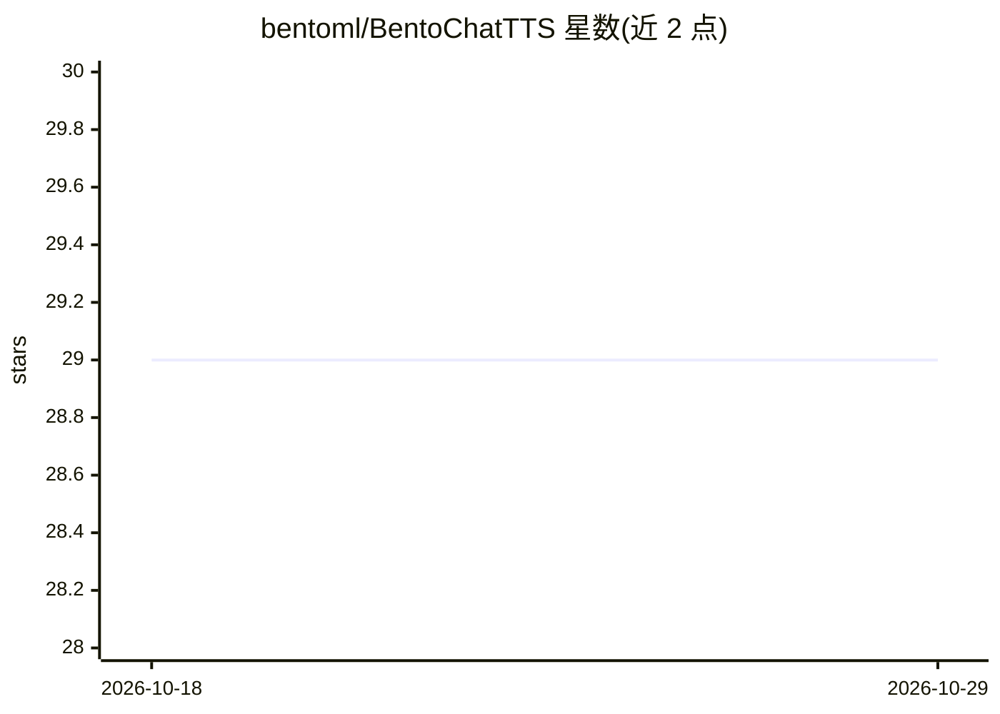

# bentoml/BentoChatTTS

⭐ 29 · Python · 推送 2026-07-14 · [GitHub](https://github.com/bentoml/BentoChatTTS) · 组织维护

**用 BentoML 部署 ChatTTS 对话语音合成模型的服务示例**

BentoML 官方示例项目：将 ChatTTS 文本转语音模型打包为 Bento 服务，通过 bentoml serve 在本地 3000 端口启动 API 服务，可用 Swagger UI 交互；也可用 bentoml deploy 一键部署到 BentoCloud。面向希望在生产环境中接入对话场景 TTS 的开发者。安装方式为 git clone 源码加 pip 安装依赖，推荐 Python 3.11，运行前需系统安装 libsox-dev。

## 筛选速览

| 维度 | 判定 | 备注 |
|---|---|---|
| AI 角色 | `ai-native` | 本体是模型或模型工具 |
| 许可风险 | `none` | — |
| 部署形态 | `library` | 以包/库形式分发 |
| 模型依赖 | — | README 未给出锁定关系 |
| 硬件要求 | — | 无带数字的原话,不猜 |
| 安装摩擦 | `low` | 无编译、无系统依赖或容器化 |
| 成熟度 | — | 结构信号不足 |

## 能力要点

- 将 ChatTTS 打包为 BentoML 服务（本地 API 服务与 Swagger UI）
- 支持通过 bentoml deploy 部署到 BentoCloud
- 面向 LLM 助手等对话场景的文本转语音

## 适用场景

- 为 LLM 助手搭建对话 TTS 服务
- 参考 BentoML 打包与部署语音模型的方式

## 场景标签

`语音合成` · 领域:内容生成

## 证据(README 行号)

> L3: ChatTTS is a text-to-speech model designed specifically for dialogue scenario such as LLM assistant. This example de
> L26: bentoml serve

## 星数曲线

2026-10-18 29 → 2026-10-29 29（+0）

---
*卡片 v1 · prompt 1.4 · 生成 2026-10-26 · 置信度 high · 依据 README sha `4df557a951da` · [字段定义](../../DATASET.md)*
