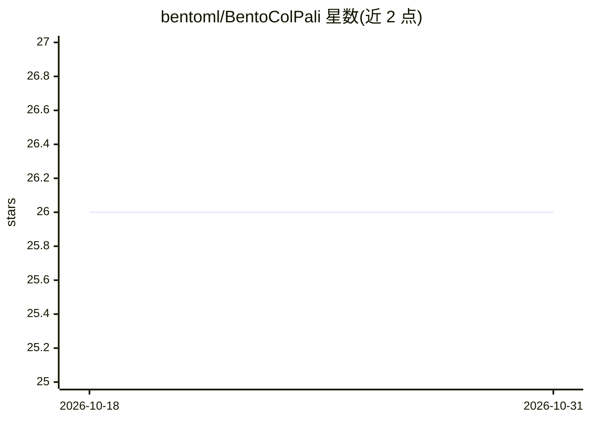

# bentoml/BentoColPali

⭐ 26 · Python · 推送 2026-07-14 · [GitHub](https://github.com/bentoml/BentoColPali) · 组织维护

**BentoML 示例项目：将 ColPali 文档检索模型封装为推理 API 服务**

BentoML 官方示例工程，演示如何将 ColPali（基于 PaliGemma-3B 视觉语言模型的多向量嵌入模型）部署为推理 API 服务。服务提供 4 条路由：图像嵌入生成、查询嵌入生成、预计算嵌入间的 MaxSim 打分，以及图像-查询一步式相似度计算。安装需 git clone 源码并 pip 安装依赖（Python 3.9+），先下载 ColPali 检查点构建模型（推荐 vidore/colpali-v1.2，需接受 Gemma 许可条款的 HuggingFace token），再以 bentoml serve 本地启动或部署到 BentoCloud。

## 筛选速览

| 维度 | 判定 | 备注 |
|---|---|---|
| AI 角色 | `ai-native` | 本体是模型或模型工具 |
| 许可风险 | `none` | — |
| 部署形态 | `library` | 以包/库形式分发 |
| 模型依赖 | — | README 未给出锁定关系 |
| 硬件要求 | — | 无带数字的原话,不猜 |
| 安装摩擦 | `low` | 无编译、无系统依赖或容器化 |
| 成熟度 | — | 结构信号不足 |

## 能力要点

- 4 条 API 路由：图像/查询嵌入生成、嵌入打分、一步式图像-查询打分
- 以单一模型替代 OCR+版面识别管线的文档检索方案
- 支持部署到 BentoCloud 或用 BentoML 生成 OCI 镜像自托管

## 适用场景

- 为文档检索系统提供 ColPali 嵌入与相似度打分 API
- 学习如何用 BentoML 封装视觉检索模型为服务
- 检索管道中去掉 OCR 与版面识别环节，直接基于文档图像生成嵌入

## 场景标签

`语义搜索` `推理引擎` · 领域:知识与检索

## 证据(README 行号)

> L3: *ColPali* leverages VLMs to construct efficient multi-vector embeddings in the visual space for document retrieval. 
> L9: This is a BentoML example project, demonstrating how to build a ColPali inference API server for ColPali. See here f
> L55: |`/embed_images`|- `items`: List of `ImagePayload`|Multi-vector embeddings|Generates image embeddings with shape (b

## 星数曲线

2026-10-18 26 → 2026-10-31 26（+0）

---
*卡片 v1 · prompt 1.4 · 生成 2026-10-26 · 置信度 mid · 依据 README sha `ddb6e0cb373a` · [字段定义](../../DATASET.md)*
