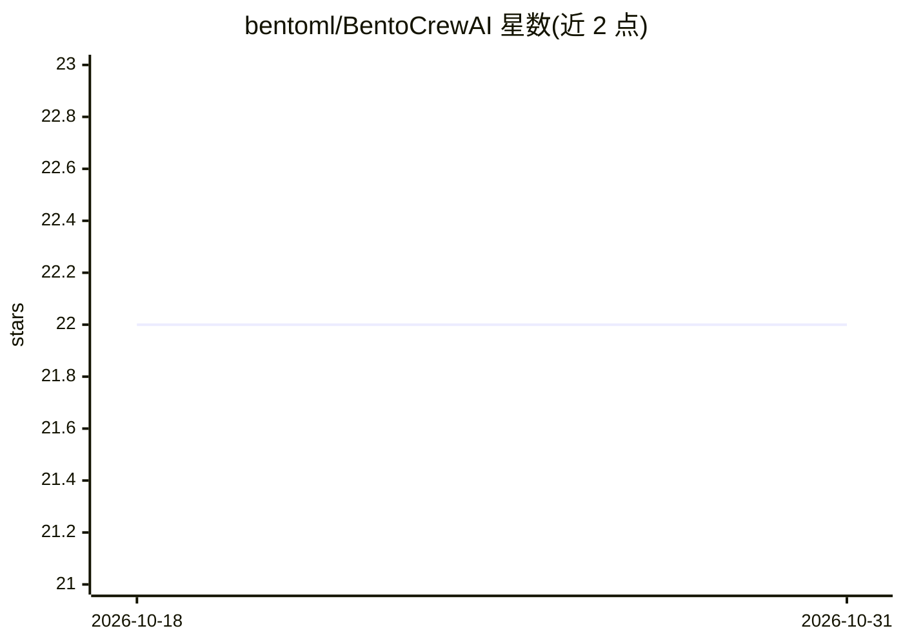

# bentoml/BentoCrewAI

⭐ 22 · Python · 推送 2026-10-22 · [GitHub](https://github.com/bentoml/BentoCrewAI) · 组织维护

**示例工程：用 BentoML 将 CrewAI 多智能体部署为 REST API**

BentoML 团维护的参考实现：演示如何用 BentoML serving 框架把 CrewAI 多智能体应用封装为 REST API。提供 /run 返回最终结果、/stream 流式返回中间规划与思考过程；通过 agents.yaml/tasks.yaml/crew.py 自定义智能体与任务；可用 bentoml containerize 构建容器镜像部署。默认使用 OpenAI API key，README 给出经 OpenLLM/BentoCloud 自托管开源 LLM 并接入的路径。声明为可改造的 playground，非成品；存在 opentelemetry-api 版本冲突的已知问题。

## 筛选速览

| 维度 | 判定 | 备注 |
|---|---|---|
| AI 角色 | `ai-ecosystem` | LLM/agent 周边工具 |
| 许可风险 | `none` | — |
| 部署形态 | `self-host` | docker 或自建部署 |
| 模型依赖 | — | README 未给出锁定关系 |
| 硬件要求 | — | 无带数字的原话,不猜 |
| 安装摩擦 | `low` | 无编译、无系统依赖或容器化 |
| 成熟度 | — | 结构信号不足 |

## 能力要点

- /run 与 /stream 端点，后者流式输出中间结果
- bentoml build/containerize 一键容器化部署
- 通过 YAML 与 crew.py 自定义智能体、任务与工具
- 支持接入 OpenLLM 自托管开源 LLM

## 适用场景

- 把 CrewAI 多智能体应用打包成可部署的 REST API
- 学习 BentoML serving 框架服务 agent 的参考实现
- 私有化部署开源 LLM 供 CrewAI 使用

## 场景标签

`多智能体` · 领域:Agent 开发

## 证据(README 行号)

> L3: Welcome to the BentoCrewAI project. This project demonstrates how to serve and deploy a CrewAI multi-agent applicati
> L33: ./venv/bin/bentoml serve bento_crew_demo.service:CrewAgent
> L83: We recommend using OpenLLM on BentoCloud

## 星数曲线

2026-10-18 22 → 2026-10-31 22（+0）

---
*卡片 v1 · prompt 1.4 · 生成 2026-10-28 · 置信度 mid · 依据 README sha `7f3e49a6a5de` · [字段定义](../../DATASET.md)*
