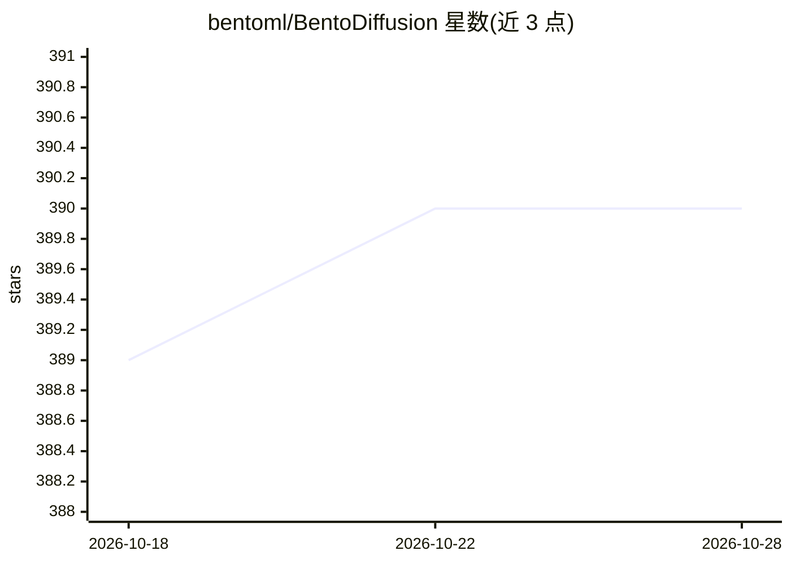

# bentoml/BentoDiffusion

⭐ 390 · Python · Apache-2.0 · 推送 2026-10-26 · [GitHub](https://github.com/bentoml/BentoDiffusion) · [官网](https://bentoml.com) · 组织维护

**用 BentoML 自托管 Stable Diffusion 系列扩散模型的示例项目集**

BentoML 官方维护的扩散模型部署示例集合：演示如何将 SDXL Turbo、FLUX.1、Stable Diffusion 3/3.5、ControlNet 等 Stable Diffusion 系列模型封装为 BentoML Service，提供 txt2img HTTP 接口，可本地 bentoml serve 运行或部署到 BentoCloud。本地测试建议使用至少 12GB 显存的 Nvidia GPU，推荐 Python 3.11，通过 git clone 后 pip 安装依赖运行。各模型位于对应子目录。

## 筛选速览

| 维度 | 判定 | 备注 |
|---|---|---|
| AI 角色 | `ai-ecosystem` | LLM/agent 周边工具 |
| 许可风险 | `permissive` | Apache-2.0 |
| 部署形态 | `library` | 以包/库形式分发 |
| 模型依赖 | — | README 未给出锁定关系 |
| 硬件要求 | `gpu-8g` | |
| 安装摩擦 | `low` | 无编译、无系统依赖或容器化 |
| 成熟度 | — | 结构信号不足 |

## 能力要点

- 覆盖 FLUX.1、SD 3/3.5、SDXL、ControlNet 等多个扩散模型的服务化示例
- 定义 BentoML Service 提供 txt2img HTTP 接口与 Swagger UI
- 支持部署到 BentoCloud 或生成 OCI 兼容镜像自建部署

## 适用场景

- 我要把 Stable Diffusion 系列模型自托管为 HTTP 图像生成服务
- 我要参考示例学习如何用 BentoML 服务化扩散模型
- 我要将扩散模型服务部署到 Kubernetes 或自有基础设施

## 场景标签

`图像生成` `推理引擎` · 领域:内容生成

## 证据(README 行号)

> L3: This repository contains a series of BentoML example projects, demonstrating how to deploy different models in the S
> L25: We have defined a BentoML Service in `service.py`. Run `bentoml serve` in your project directory to start the Servi
> L56: ## Deploy to BentoCloud

## 星数曲线

2026-10-18 389 → 2026-10-28 390（+1）

---
*卡片 v1 · prompt 1.4 · 生成 2026-10-21 · 置信度 mid · 依据 README sha `5b93daf4f869` · [字段定义](../../DATASET.md)*
