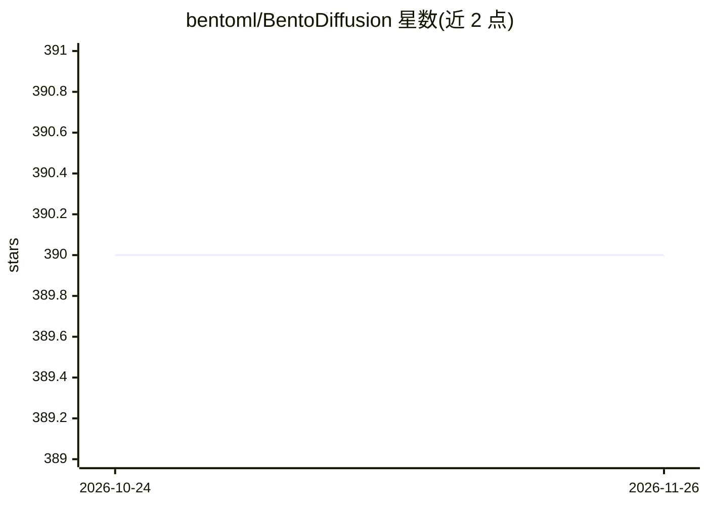

# bentoml/BentoDiffusion

⭐ 390 · Python · Apache-2.0 · 推送 2026-11-09 · [GitHub](https://github.com/bentoml/BentoDiffusion) · [官网](https://bentoml.com) · 组织维护

**开发者：用 BentoML 部署 Diffusion 图像生成模型服务**

一组 BentoML 示例项目集合，演示如何以服务形式部署 Stable Diffusion 系列扩散模型（含 FLUX.1、SD3、SDXL Turbo、ControlNet 等）。仓库以 SDXL Turbo 为例给出完整流程：git clone 后 pip 安装依赖，service.py 中定义 BentoML Service，bentoml serve 启动后经 /txt2img 端点以 CURL 或 Python 客户端调用，支持生成 OCI 镜像做自定义部署。本地测试建议至少 12GB 显存的 Nvidia GPU。

## 筛选速览

| 维度 | 判定 | 备注 |
|---|---|---|
| AI 角色 | `ai-native` | 本体是模型或模型工具 |
| 许可风险 | `permissive` | Apache-2.0 |
| 部署形态 | `library` | 以包/库形式分发 |
| 模型依赖 | — | README 未给出锁定关系 |
| 硬件要求 | `gpu-8g` | |
| 安装摩擦 | `low` | 无编译、无系统依赖或容器化 |
| 成熟度 | — | 结构信号不足 |

## 能力要点

- 收录多个 SD 系列模型的部署示例子目录（FLUX.1/SD3/SDXL 等）
- 提供 txt2img 的 CURL 与 Python 客户端调用示例
- 支持用 BentoML 生成 OCI 兼容镜像进行自定义部署

## 适用场景

- 在自己的服务器上以 HTTP 服务形式部署 Stable Diffusion 文生图模型
- 生成 OCI 镜像把扩散模型部署到自有基础设施
- 参考不同扩散模型的部署示例子目录做接入

## 场景标签

`图像生成` `推理引擎` · 领域:内容生成

## 证据(README 行号)

> L3: This repository contains a series of BentoML example projects, demonstrating how to deploy different models in the S
> L23: We have defined a BentoML Service in `service.py`. Run `bentoml serve` in your project directory to start the Servi

## 星数曲线

2026-10-24 390 → 2026-11-26 390（+0）

---
*卡片 v1 · prompt 1.4 · 生成 2026-11-25 · 置信度 high · 依据 README sha `c946053c59b9` · [字段定义](../../DATASET.md)*
