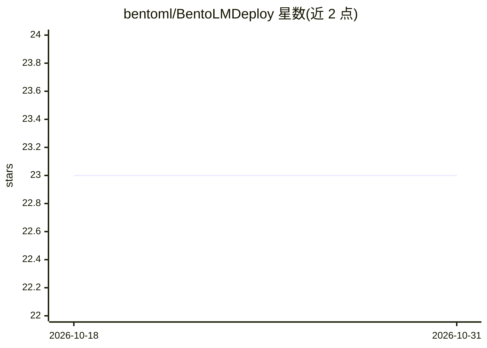

# bentoml/BentoLMDeploy

⭐ 23 · Python · 推送 2026-07-14 · [GitHub](https://github.com/bentoml/BentoLMDeploy) · 组织维护

**BentoML 示例工程：用 LMDeploy 自托管部署开源 LLM**

BentoML 官方示例项目，演示如何用 LMDeploy（LLM 压缩、部署与服务工具包）加载并服务开源大语言模型，默认使用 Llama 3 8B Instruct。流程为：克隆仓库、pip 安装依赖、运行脚本下载模型、bentoml serve 启动 HTTP 服务（暴露 /generate 流式接口，支持 Swagger UI、curl、Python 客户端访问），并可一键部署到 BentoCloud 或生成 OCI 镜像自托管。本地测试需 Nvidia GPU（≥20G VRAM）。README 定位为代码定制基础，无代码托管场景指向 OpenLLM。

## 筛选速览

| 维度 | 判定 | 备注 |
|---|---|---|
| AI 角色 | `ai-ecosystem` | LLM/agent 周边工具 |
| 许可风险 | `none` | — |
| 部署形态 | `library` | 以包/库形式分发 |
| 模型依赖 | — | README 未给出锁定关系 |
| 硬件要求 | `gpu-8g` | |
| 安装摩擦 | `low` | 无编译、无系统依赖或容器化 |
| 成熟度 | — | 结构信号不足 |

## 能力要点

- 以 LMDeploy 为推理后端封装 Llama 3 8B Instruct 为 BentoML Service
- bentoml serve 启动生产 HTTP 服务，/generate 接口支持 SSE 流式输出
- 支持部署到 BentoCloud 或生成 OCI 兼容镜像自托管

## 适用场景

- 基于此模板自定义模型、推理逻辑或 LMDeploy 参数来部署开源 LLM
- 本地起服务测试 LMDeploy 推理效果
- 部署到 BentoCloud 做托管与扩缩容

## 场景标签

`推理引擎` · 领域:训练与推理

## 证据(README 行号)

> L3: This is a BentoML example project, showing you how to serve and deploy open-source Large Language Models (LLMs) usin
> L35: We have defined a BentoML Service in `service.py`. Run `bentoml serve` in your project directory to start the Servi

## 星数曲线

2026-10-18 23 → 2026-10-31 23（+0）

---
*卡片 v1 · prompt 1.4 · 生成 2026-10-27 · 置信度 high · 依据 README sha `447a68592d8a` · [字段定义](../../DATASET.md)*
