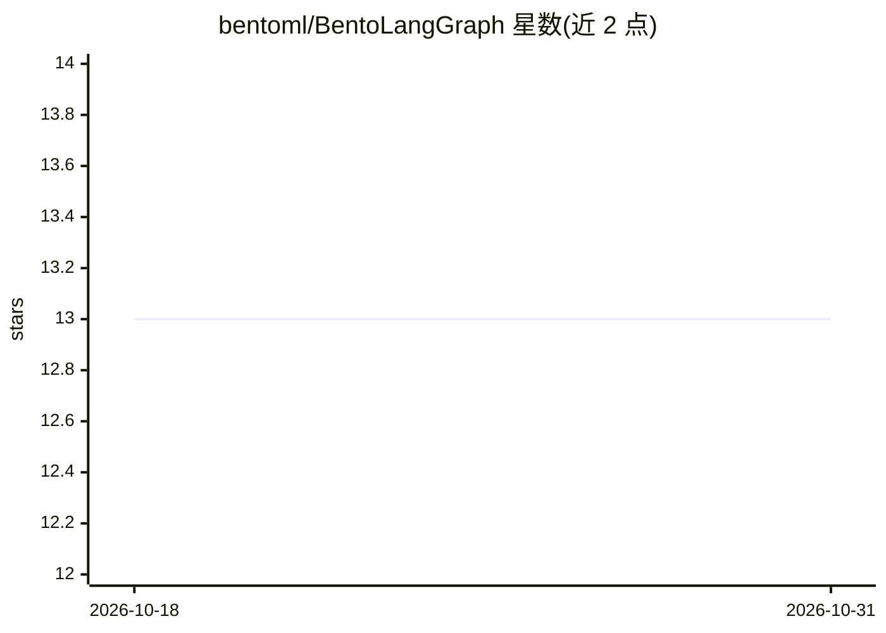

# bentoml/BentoLangGraph

⭐ 13 · Python · 推送 2026-07-14 · [GitHub](https://github.com/bentoml/BentoLangGraph) · 组织维护

**用 BentoML 将 LangGraph Agent 部署为 REST API 的示例项目**

BentoML 官方参考实现，演示如何将 LangGraph Agent 应用以 REST API 形式部署：支持同步与基于队列的异步调用，可本地运行或部署到 BentoCloud，可选用外部 LLM API 或将开源 LLM（如 Ministral 8B）与 Agent 服务一同自托管。提供分步指南（含 Anthropic Claude 3.5 Sonnet 示例），并说明 DuckDuckGo 工具的限流问题与替换方案。定位为可改造的参考实现，面向构建 Agent 服务的开发者。

## 筛选速览

| 维度 | 判定 | 备注 |
|---|---|---|
| AI 角色 | `ai-ecosystem` | LLM/agent 周边工具 |
| 许可风险 | `none` | — |
| 部署形态 | `None` |  |
| 模型依赖 | — | README 未给出锁定关系 |
| 硬件要求 | — | 无带数字的原话,不猜 |
| 安装摩擦 | `low` | 无编译、无系统依赖或容器化 |
| 成熟度 | — | 结构信号不足 |

## 能力要点

- 将 LangGraph Agent 以 REST API 形式服务化
- 支持同步与队列式异步两种调用方式
- 可选外部 LLM API 或自托管开源 LLM（如 Ministral 8B）
- 本地运行或部署到 BentoCloud

## 适用场景

- 把 LangGraph 构建的 Agent 对外暴露为 REST API
- 在 BentoCloud 上部署 Agent 服务
- 将开源 LLM 与 Agent 服务一同自托管

## 场景标签

`Agent 框架` · 领域:Agent 开发

## 证据(README 行号)

> L9: - **AI Agent Serving**: Serving LangGraph Agent as REST API for easy integration
> L12: - **LLM Deployment**: Use external LLM APIs or deploy open-source LLM together with the Agent API service

## 星数曲线

2026-10-18 13 → 2026-10-31 13（+0）

---
*卡片 v1 · prompt 1.4 · 生成 2026-10-31 · 置信度 high · 依据 README sha `e26130b4d312` · [字段定义](../../DATASET.md)*
