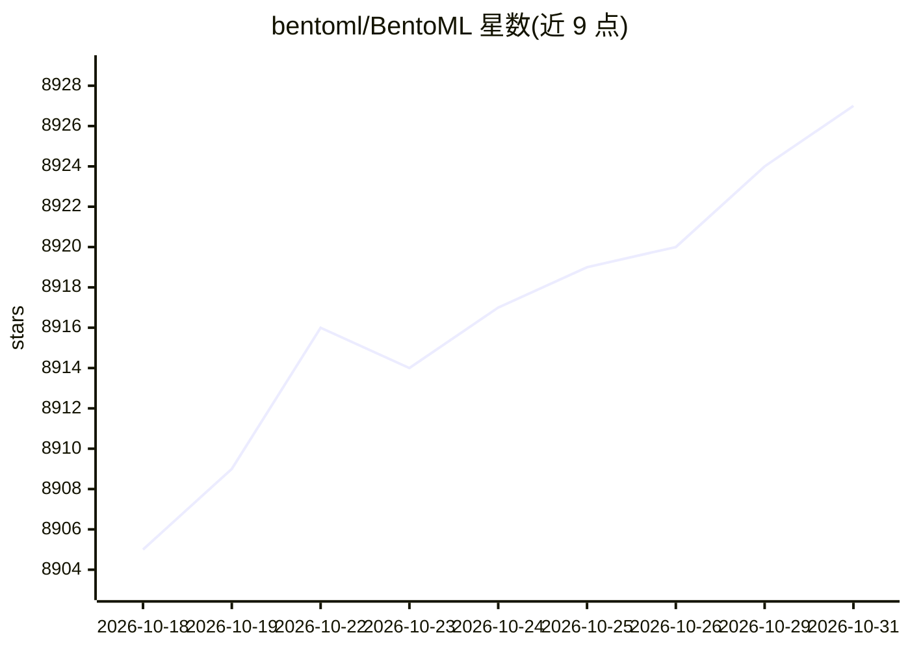

# bentoml/BentoML

⭐ 8,927 · Python · Apache-2.0 · 推送 2026-10-29 · [GitHub](https://github.com/bentoml/BentoML) · [官网](https://bentoml.com) · 组织维护

**Python 模型服务框架：把 AI 模型推理脚本构建为 API 服务**

Python 库，用于构建面向 AI 应用与模型推理的在线服务系统：通过标准 Python 类型提示将模型推理脚本转为 REST API 服务器，支持动态批处理、模型并行、多模型推理图编排等性能优化。以 Bento 为标准化部署工件，可自动生成 Docker 镜像部署，也可部署到 BentoCloud；需 Python≥3.9，本地运行示例另需安装 PyTorch/Transformers。面向构建生产级模型推理服务的开发者。

## 筛选速览

| 维度 | 判定 | 备注 |
|---|---|---|
| AI 角色 | `ai-ecosystem` | LLM/agent 周边工具 |
| 许可风险 | `permissive` | Apache-2.0 |
| 部署形态 | `self-host` | docker 或自建部署 |
| 模型依赖 | — | README 未给出锁定关系 |
| 硬件要求 | — | 无带数字的原话,不猜 |
| 安装摩擦 | `low` | 无编译、无系统依赖或容器化 |
| 成熟度 | — | 结构信号不足 |

## 能力要点

- 以类型提示将任意模型脚本转为 REST API 服务
- 动态批处理、模型并行、多模型推理图编排等内置优化
- bentoml build/containerize 生成标准化 Bento 工件与 Docker 镜像
- 示例覆盖 LLM、图像生成、Embedding、音频、计算机视觉等模型

## 适用场景

- 把开源或自定义模型封装为生产可用的推理 API
- 本地开发调试后用 Docker 或 BentoCloud 部署到生产环境
- 构建多模型组合与推理流水线服务

## 场景标签

`推理引擎` `MLOps` · 领域:训练与推理

## 证据(README 行号)

> L14: BentoML is a Python library for building online serving systems optimized for AI apps and model inference.
> L16: - **🍱 Easily build APIs for Any AI/ML Model.** Turn any model inference script into a REST API server with just a f

## 星数曲线

2026-10-18 8,905 → 2026-10-31 8,927（+22）

---
*卡片 v1 · prompt 1.4 · 生成 2026-10-20 · 置信度 high · 依据 README sha `b561ae818048` · [字段定义](../../DATASET.md)*
