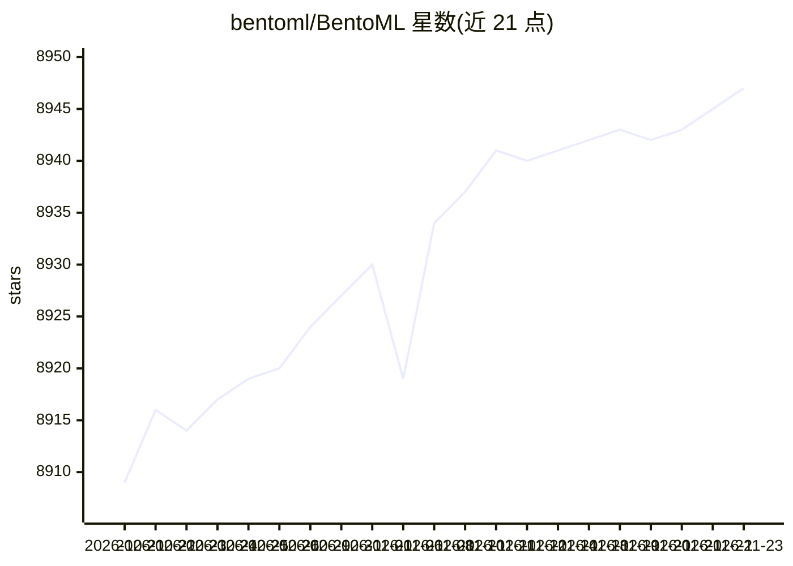

# bentoml/BentoML

⭐ 8,947 · Python · Apache-2.0 · 推送 2026-11-17 · [GitHub](https://github.com/bentoml/BentoML) · [官网](https://bentoml.com) · 组织维护

**面向 AI 应用的 Python 模型服务框架：推理 API 与部署**

BentoML 是一个用于构建在线服务系统的 Python 库，针对 AI 应用与模型推理优化：将模型推理脚本以几行代码转为 REST API 服务端，通过配置文件管理依赖与模型版本并自动生成 Docker 镜像，支持动态批处理、模型并行、多阶段流水线与多模型编排。本地用 `bentoml serve` 运行，`bentoml build` 打包为 Bento 工件，`bentoml containerize` 生成容器镜像以部署到 Docker 或 Kubernetes。需 Python≥3.9，运行收集匿名使用数据，可用参数或环境变量关闭。

## 筛选速览

| 维度 | 判定 | 备注 |
|---|---|---|
| AI 角色 | `ai-ecosystem` | LLM/agent 周边工具 |
| 许可风险 | `permissive` | Apache-2.0 |
| 部署形态 | `self-host` | docker 或自建部署 |
| 模型依赖 | — | README 未给出锁定关系 |
| 硬件要求 | — | 无带数字的原话,不猜 |
| 安装摩擦 | `low` | 无编译、无系统依赖或容器化 |
| 成熟度 | — | 结构信号不足 |

## 能力要点

- 几行代码将任意模型推理脚本转为 REST API 服务
- 自动生成 Docker 镜像，支持 Kubernetes 部署
- 内置动态批处理、模型并行与多模型推理编排
- 示例覆盖 LLM、图像生成、嵌入、音频、计算机视觉等模态

## 适用场景

- 为自己的模型快速搭建生产级推理 API
- 将模型服务容器化后部署到集群
- 构建多模型组合与任务队列服务

## 场景标签

`推理引擎` `MLOps` · 领域:训练与推理

## 证据(README 行号)

> L14: BentoML is a Python library for building online serving systems optimized for AI apps and model inference.
> L18: - **🧭 Maximize CPU/GPU utilization.** Build high performance inference APIs leveraging built-in serving optimizatio

## 星数曲线

2026-10-21 8,909 → 2026-11-23 8,947（+38）

---
*卡片 v1 · prompt 1.4 · 生成 2026-11-22 · 置信度 high · 依据 README sha `84b6f81dddfb` · [字段定义](../../DATASET.md)*
