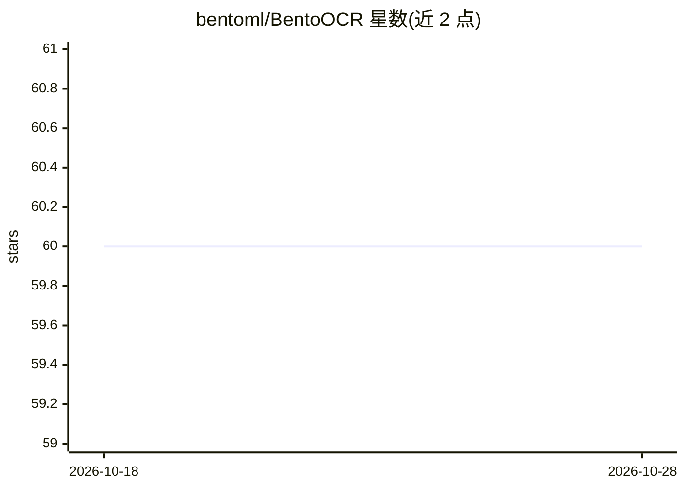

# bentoml/BentoOCR

⭐ 60 · Python · 推送 2026-10-22 · [GitHub](https://github.com/bentoml/BentoOCR) · [官网](https://bentoml.com) · 组织维护

**将 OCR 模型部署为在线推理 API 的 BentoML 示例工程**

BentoML 官方示例项目：以 EasyOCR 为例演示如何将 OCR 模型导入 BentoML Model Store 并通过 service.py 暴露为 HTTP 推理服务。提供 detect 与 classify 两个端点，分别返回文本区域及边界框坐标、文本与置信度。安装流程为 uv + git clone + pip 安装依赖，运行 bentoml serve 后可通过 Swagger UI、cURL 或 Python 客户端调用，并支持部署到 BentoCloud。可替换为其他 OCR 模型。

## 筛选速览

| 维度 | 判定 | 备注 |
|---|---|---|
| AI 角色 | `ai-ecosystem` | LLM/agent 周边工具 |
| 许可风险 | `none` | — |
| 部署形态 | `library` | 以包/库形式分发 |
| 模型依赖 | — | README 未给出锁定关系 |
| 硬件要求 | — | 无带数字的原话,不猜 |
| 安装摩擦 | `low` | 无编译、无系统依赖或容器化 |
| 成熟度 | — | 结构信号不足 |

## 能力要点

- 以 EasyOCR 为例，可替换任意 OCR 模型
- detect/classify 两个端点，返回文本、边界框与置信度
- 支持 bentoml serve 本地服务与 BentoCloud 部署

## 适用场景

- 把 OCR 模型快速包装成 HTTP API 服务
- 学习 BentoML 模型导入与 Service 定义流程
- 在 BentoCloud 上部署 OCR 推理应用

## 场景标签

`OCR` · 领域:感知与多模态

## 证据(README 行号)

> L3: This is a BentoML example project that demonstrates how to serve an OCR model. It accepts images as input and return
> L29: We have defined a BentoML Service in `service.py` to serve the model. To start it, run:

## 星数曲线

2026-10-18 60 → 2026-10-28 60（+0）

---
*卡片 v1 · prompt 1.4 · 生成 2026-10-24 · 置信度 mid · 依据 README sha `884a6169fb3c` · [字段定义](../../DATASET.md)*
