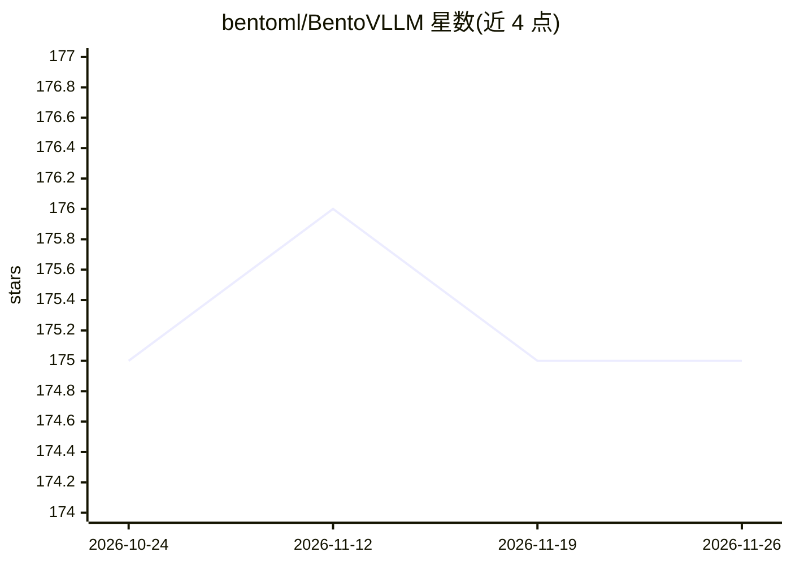

# bentoml/BentoVLLM

⭐ 175 · Python · Apache-2.0 · 推送 2026-11-09 · [GitHub](https://github.com/bentoml/BentoVLLM) · 组织维护

**用 vLLM 与 BentoML 自托管部署开源 LLM 的示例集**

一组 BentoML 示例项目，展示如何以 vLLM 推理引擎部署开源大模型；每个模型目录含 service.py，通过 BentoML Service 暴露 OpenAI 兼容端点，支持 vLLM 扩展参数（如 guided_json 强制 JSON 输出），并可用 BentoML 生成 OCI 镜像做自定义部署。仓库收录约 24 个模型示例（DeepSeek、Llama、Qwen3、Phi-4、Gemma3 等）。定位为二次开发基础；免代码简单托管指向同组织的 OpenLLM 项目。

## 筛选速览

| 维度 | 判定 | 备注 |
|---|---|---|
| AI 角色 | `ai-ecosystem` | LLM/agent 周边工具 |
| 许可风险 | `permissive` | Apache-2.0 |
| 部署形态 | `None` |  |
| 模型依赖 | local-ok | 支持本地模型 |
| 硬件要求 | `gpu-8g` | |
| 安装摩擦 | `medium` | 含编译或系统依赖之一 |
| 成熟度 | — | 结构信号不足 |

## 能力要点

- 每个模型目录提供 OpenAI 兼容端点的 BentoML Service 代码
- 支持 vLLM 扩展参数（guided_json 等）
- 可生成 OCI 兼容镜像用于自有基础设施部署
- 收录 DeepSeek-V3/R1、Qwen3、Llama 3.1-4 等多个模型示例目录

## 适用场景

- 在自己的基础设施上以 OpenAI 兼容 API 服务开源大模型
- 基于示例定制模型、推理逻辑或 vLLM 参数
- 用 BentoML 打包镜像进行生产部署

## 场景标签

`推理引擎` · 领域:训练与推理

## 证据(README 行号)

> L3: This repository contains a group of BentoML example projects, showing you how to serve and deploy open-source Large 
> L25: We have defined a BentoML Service in `service.py`. Run `bentoml serve` in your project directory to start the Servi
> L58: For custom deployment in your own infrastructure, use BentoML to generate an OCI-compliant image.

## 星数曲线

2026-10-24 175 → 2026-11-26 175（+0）

---
*卡片 v1 · prompt 1.4 · 生成 2026-11-26 · 置信度 high · 依据 README sha `c1f20dc4426d` · [字段定义](../../DATASET.md)*
