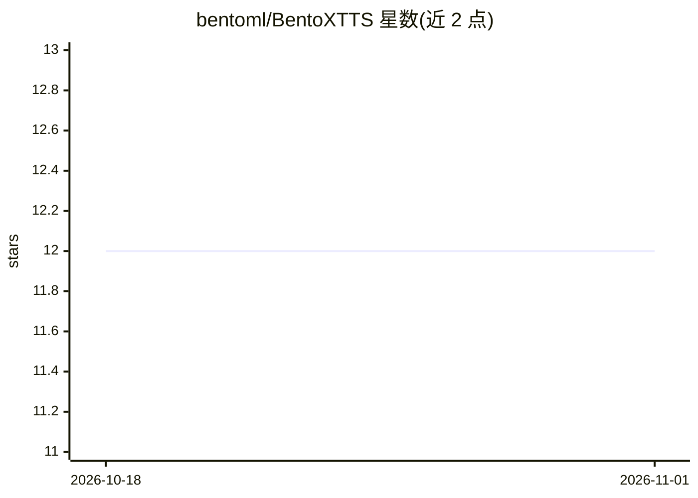

# bentoml/BentoXTTS

⭐ 12 · Python · 推送 2026-07-14 · [GitHub](https://github.com/bentoml/BentoXTTS) · 组织维护

**用 BentoML 部署 XTTS 语音克隆模型的服务示例项目**

BentoML 官方示例工程，演示如何将 XTTS 语音生成模型封装为 text-to-speech 推理 API 服务。XTTS 可用 6 秒音频样本克隆声音到不同语言。项目提供 service.py 定义 BentoML Service，通过 bentoml serve 本地启动 HTTP 服务（默认 3000 端口），支持 Swagger UI、curl 与 Python 客户端调用，并可一键部署到 BentoCloud 或生成 OCI 镜像自托管。需同意 Coqui TTS 条款，推荐 Python 3.11。

## 筛选速览

| 维度 | 判定 | 备注 |
|---|---|---|
| AI 角色 | `ai-native` | 本体是模型或模型工具 |
| 许可风险 | `none` | — |
| 部署形态 | `library` | 以包/库形式分发 |
| 模型依赖 | — | README 未给出锁定关系 |
| 硬件要求 | — | 无带数字的原话,不猜 |
| 安装摩擦 | `low` | 无编译、无系统依赖或容器化 |
| 成熟度 | — | 结构信号不足 |

## 能力要点

- 将 XTTS 声音克隆模型封装为 HTTP 推理 API
- 提供 Swagger UI、curl、Python 客户端调用示例
- 支持部署到 BentoCloud 或生成 OCI 镜像自托管

## 适用场景

- 为 XTTS 语音克隆模型搭建可调用的推理 API 服务
- 学习如何用 BentoML 打包语音生成模型
- 部署多语言文本转语音服务到云端或自有基础设施

## 场景标签

`语音合成` · 领域:内容生成

## 证据(README 行号)

> L3: XTTS is a voice generation model that lets you clone voices into different languages by using just a quick 6-second 
> L5: This is a BentoML example project, demonstrating how to build a text-to-speech inference API server using the XTTS m

## 星数曲线

2026-10-18 12 → 2026-11-01 12（+0）

---
*卡片 v1 · prompt 1.4 · 生成 2026-11-01 · 置信度 mid · 依据 README sha `e37f9c6372e5` · [字段定义](../../DATASET.md)*
