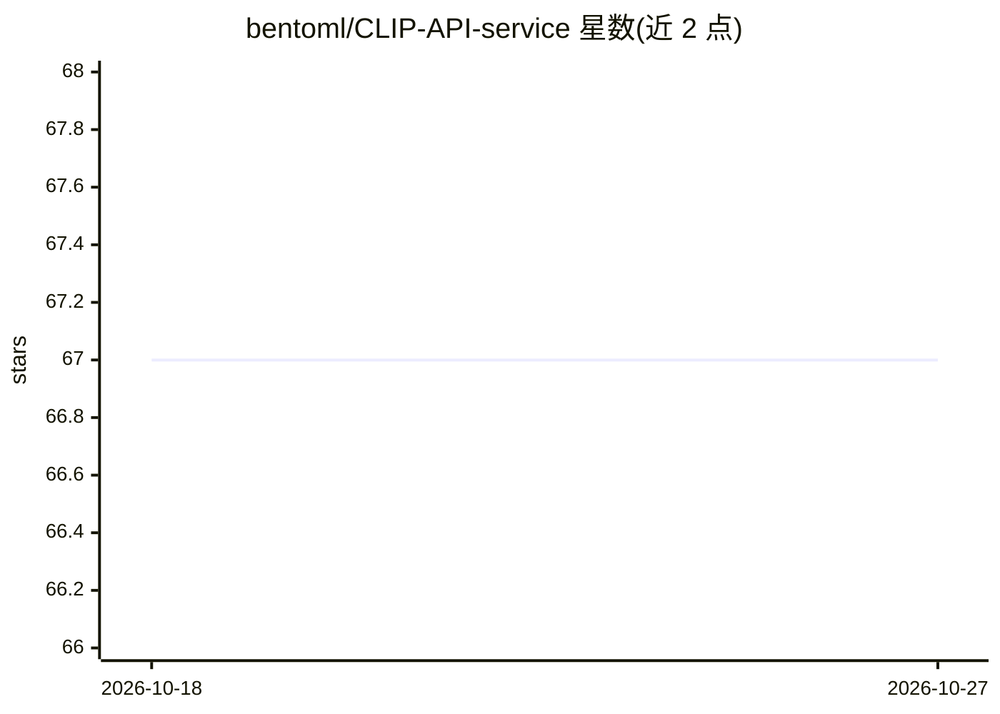

# bentoml/CLIP-API-service

⭐ 67 · Jupyter Notebook · Apache-2.0 · 推送 2026-10-22 · [GitHub](https://github.com/bentoml/CLIP-API-service) · [官网](https://bentoml.com) · 组织维护

**将 OpenAI CLIP 模型封装为即用 API 服务的工具**

基于 BentoML 的 CLIP 模型服务封装：pip 安装后通过 CLI 启动 HTTP 服务，提供 /encode 接口将文本或图片转为 768 维嵌入向量，/rank 接口做零样本图像分类、候选匹配与视觉推理（计数、颜色、位置等），支持指定不同 CLIP 模型（默认 openai/clip-vit-large-patch14）。面向需要快速集成 CLIP 能力的开发者，可通过 build/push 命令部署到 BentoCloud。注意：仓库已声明弃用，官方指引迁移到 BentoCLIP。

## 筛选速览

| 维度 | 判定 | 备注 |
|---|---|---|
| AI 角色 | `ai-native` | 本体是模型或模型工具 |
| 许可风险 | `permissive` | Apache-2.0 |
| 部署形态 | `library` | 以包/库形式分发 |
| 模型依赖 | — | README 未给出锁定关系 |
| 硬件要求 | — | 无带数字的原话,不猜 |
| 安装摩擦 | `low` | 无编译、无系统依赖或容器化 |
| 成熟度 | — | 结构信号不足 |

## 能力要点

- /encode 接口输出 768 维文本/图像嵌入
- /rank 接口支持零样本分类与视觉推理
- CLI 可切换多个 CLIP 模型并构建 Bento 部署
- 自带 Swagger UI 便于本地调用测试

## 适用场景

- 给图片或文本生成嵌入向量用于神经搜索或自定义排序
- 不做训练即可对图片做零样本分类
- 把 CLIP 服务部署到生产环境供应用调用

## 场景标签

`推理引擎` · 领域:训练与推理

## 证据(README 行号)

> L3:  Discover the effortless integration of OpenAI's innovative CLIP model with our streamlined API service.
> L26: clip-api-service serve --model-name=ViT-B-32:openai
> L44:  - Use `rank` to perform image classification without any training. For example:

## 星数曲线

2026-10-18 67 → 2026-10-27 67（+0）

---
*卡片 v1 · prompt 1.4 · 生成 2026-10-24 · 置信度 high · 依据 README sha `40d7f8aec93c` · [字段定义](../../DATASET.md)*
