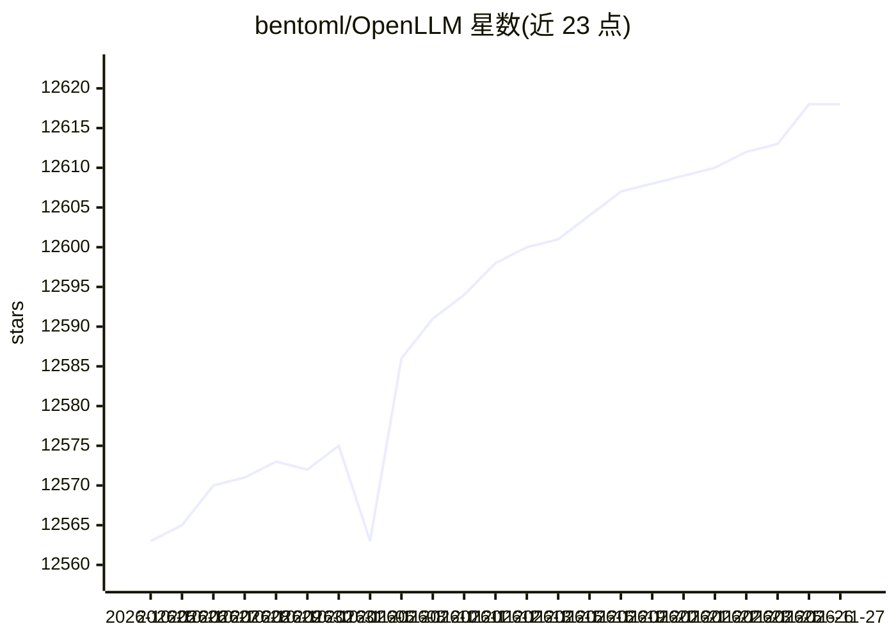

# bentoml/OpenLLM

⭐ 12,618 · Python · Apache-2.0 · 推送 2026-11-23 · [GitHub](https://github.com/bentoml/OpenLLM) · [官网](https://bentoml.com) · 组织维护

**开发者一条命令自托管开源 LLM，输出 OpenAI 兼容 API**

OpenLLM 提供一条命令将开源 LLM（Llama 3.3、Qwen2.5、Phi3 等）或自定义模型作为 OpenAI 兼容 API 运行，附内置聊天 UI，并支持通过 Docker 与 Kubernetes 做云部署。模型不存权重，gated 模型需 HF_TOKEN。模型通过 BentoML 打包的 Bento 组织成模型仓库，可添加自定义仓库（当前仅支持公共仓库）。推理后端使用 vLLM。面向开发者的 LLM 服务化工具。

## 筛选速览

| 维度 | 判定 | 备注 |
|---|---|---|
| AI 角色 | `ai-ecosystem` | LLM/agent 周边工具 |
| 许可风险 | `permissive` | Apache-2.0 |
| 部署形态 | `library` | 以包/库形式分发 |
| 模型依赖 | local-ok | 支持本地模型 |
| 硬件要求 | — | 无带数字的原话,不猜 |
| 安装摩擦 | `low` | 无编译、无系统依赖或容器化 |
| 成熟度 | — | 结构信号不足 |

## 能力要点

- 一条命令启动 LLM 服务器，提供 OpenAI 兼容 API
- 内置 /chat 端点的聊天 UI 与 CLI 聊天命令
- 基于 BentoML 的模型仓库机制，支持添加自定义模型仓库
- 支持 Docker 与 Kubernetes 云部署流程

## 适用场景

- 在本地或云端把开源 LLM 跑成 OpenAI 兼容接口给应用调用
- 用内置聊天 UI 或 CLI 与模型交互
- 维护团队私有的模型仓库与自定义模型部署

## 场景标签

`推理引擎` · 领域:训练与推理

## 证据(README 行号)

> L9: OpenLLM allows developers to run **any open-source LLMs** (Llama 3.3, Qwen2.5, Phi3 and more) or **custom models** a
> L215: - vllm-project/vllm for production level LLM backend

## 星数曲线

2026-10-25 12,563 → 2026-11-27 12,618（+55）

---
*卡片 v1 · prompt 1.4 · 生成 2026-11-22 · 置信度 high · 依据 README sha `87a7ee5ba9ed` · [字段定义](../../DATASET.md)*
