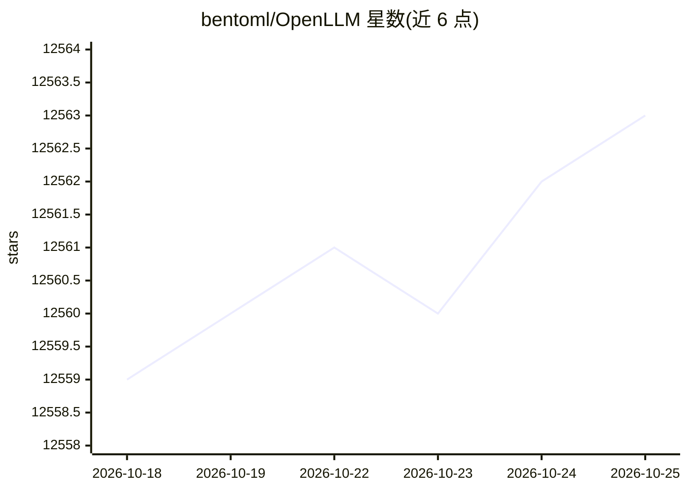

# bentoml/OpenLLM

⭐ 12,565 · Python · Apache-2.0 · 推送 2026-10-22 · [GitHub](https://github.com/bentoml/OpenLLM) · [官网](https://bentoml.com) · 组织维护

**把开源 LLM 一条命令跑成 OpenAI 兼容 API 服务**

面向开发者的 LLM 自托管运行工具：通过 pip 安装后，用 openllm serve 命令将 Llama 3.3、Qwen2.5、DeepSeek 等开源模型或自定义模型启动为 OpenAI 兼容 API 端点，内置 Chat UI 与 CLI 对话。以模型仓库目录管理可用模型，支持添加自定义仓库（基于 BentoML 构建 Bento）。不存储模型权重，受限模型需设置 HF_TOKEN。支持经 BentoML、Docker、Kubernetes 与 BentoCloud 部署到云端。

## 筛选速览

| 维度 | 判定 | 备注 |
|---|---|---|
| AI 角色 | `ai-ecosystem` | LLM/agent 周边工具 |
| 许可风险 | `permissive` | Apache-2.0 |
| 部署形态 | `library` | 以包/库形式分发 |
| 模型依赖 | — | README 未给出锁定关系 |
| 硬件要求 | — | 无带数字的原话,不猜 |
| 安装摩擦 | `low` | 无编译、无系统依赖或容器化 |
| 成熟度 | — | 结构信号不足 |

## 能力要点

- 单命令将开源/自定义 LLM 启动为 OpenAI 兼容 API
- 内置 Chat UI（/chat 端点）与 CLI 对话（openllm run）
- 模型仓库目录机制，支持添加公共自定义仓库
- openllm deploy 一键部署到 BentoCloud，支持 Docker/Kubernetes

## 适用场景

- 本地把开源 LLM 跑成 OpenAI 兼容 API 供现有工具调用
- 用 LlamaIndex/OpenAI 客户端等框架对接自托管模型
- 部署 LLM 到企业云环境（BentoCloud/Kubernetes）

## 场景标签

`推理引擎` · 领域:训练与推理

## 证据(README 行号)

> L9: OpenLLM allows developers to run **any open-source LLMs** (Llama 3.3, Qwen2.5, Phi3 and more) or **custom models** a
> L208: OpenLLM supports LLM cloud deployment via BentoML, the unified model serving framework, and BentoCloud, an AI infe

## 星数曲线

2026-10-18 12,559 → 2026-10-25 12,563（+4）

---
*卡片 v1 · prompt 1.4 · 生成 2026-10-20 · 置信度 high · 依据 README sha `45e0eed4359d` · [字段定义](../../DATASET.md)*
