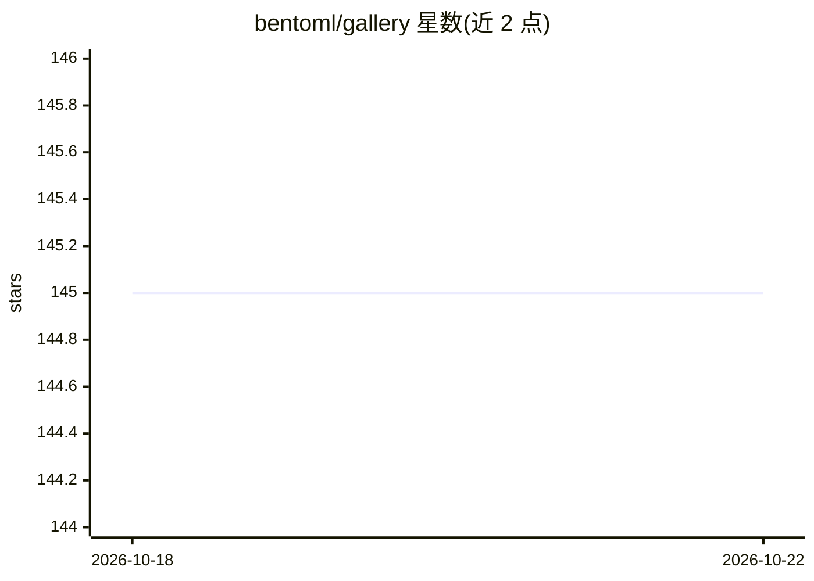

# bentoml/gallery

⭐ 145 · 推送 2026-07-14 · [GitHub](https://github.com/bentoml/gallery) · [官网](https://bentoml.com) · 组织维护

**BentoML 官方示例项目集合**

BentoML 组织维护的示例项目库（Gallery），提供展示 BentoML 模型部署与工作流用法的示例工程集合。README 内容极少，仅在标题处说明项目性质并引导用户加入 Slack 社区交流；具体示例内容与安装方式需查看各子目录工程。主题标签显示示例覆盖 AWS Lambda、SageMaker、Azure ML、GCP Cloud Functions 等部署场景。

## 筛选速览

| 维度 | 判定 | 备注 |
|---|---|---|
| AI 角色 | `ai-knowledge` | 知识聚合/清单类 |
| 许可风险 | `none` | — |
| 部署形态 | `None` |  |
| 模型依赖 | — | README 未给出锁定关系 |
| 硬件要求 | — | 无带数字的原话,不猜 |
| 安装摩擦 | `low` | 无编译、无系统依赖或容器化 |
| 成熟度 | — | 结构信号不足 |

## 能力要点

- BentoML 官方组织的示例项目集合
- 主题标签覆盖模型部署与多云平台场景
- 提供 Slack 社区支持渠道

## 适用场景

- 查找 BentoML 各部署场景的示例工程
- 参考云端部署（AWS/Azure/GCP）的模型上线做法

## 场景标签

`精选清单` · 领域:学习与行业

## 证据(README 行号)

> L1: BentoML
> L3: # BentoML Gallery 🎨 Twitter Follow Slack

## 星数曲线

2026-10-18 145 → 2026-10-22 145（+0）

---
*卡片 v1 · prompt 1.4 · 生成 2026-10-22 · 置信度 low · 依据 README sha `2985948b6791` · [字段定义](../../DATASET.md)*
